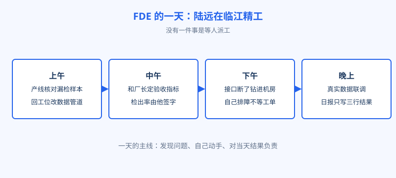
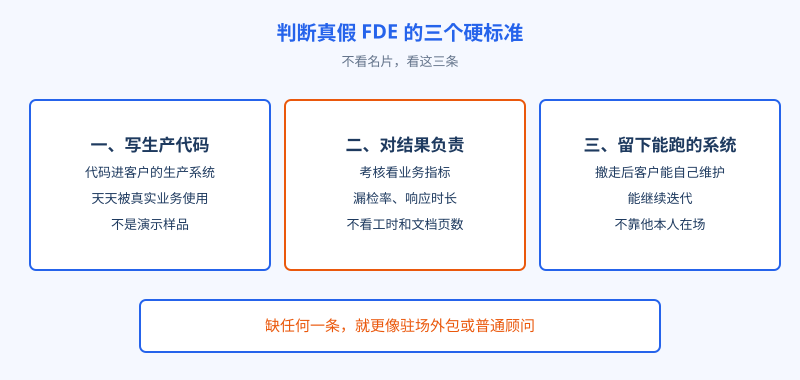

# 第 1 章 不是驻场外包

## 开场

先看陆远入驻临江精工第一周的一个普通工作日。上午他蹲在产线边，和设备科的王工一起核对昨天的漏检样本，回到工位就改数据管道的代码。中午他和厂长、质量部长开会，把「检出率要做到多少才算能上线」当场定下来，这个数是他签字的。下午 MES 系统的接口又断了，他直接钻进机房排障，因为晚上和产线约好了做第一次真实数据联调。一天结束，他的日报里只有三行：改了什么、测出什么、明天交付什么。

这一天里没有一件事像传统驻场外包：等人派工、按清单干活、干完交差。陆远的样子，更像这家工厂临时多了一个要对结果负责的技术负责人。把这一天按时间轴画出来，就是下面这张图。这一章就把这件事说清：FDE 是什么，和驻场外包差在哪里。

图：FDE 的一天：时间不是花在「等任务」上，而是花在业务现场、生产代码和对结果的确认上。

## 白话讲解

FDE 的全称是 Forward Deployed Engineer，直译就是前线部署工程师。forward 是军事用语，指把部队部署到离前线最近的位置。放到软件行业，就是把工程师派到离客户业务最近的地方，常驻现场干活。顺带说一句，这个名字常被误写成 forwarded，多了一个 d，意思就全变了，要注意。本书统一用「前线部署工程师」这个译名，北京的政策文件里写作「前沿部署工程师」，指的是同一个岗位。

给它一个能直接用的定义：FDE 是供职于产品方、嵌入客户现场的工程师，他在客户的真实环境里写生产代码、做系统集成，并且对业务结果负责，直到系统真正跑起来。

判断一个人是不是 FDE，不看他的名片，看三个硬标准。第一，写生产代码。他交出去的东西要进客户的生产系统，天天被真实业务使用，不是演示用的样品。第二，对结果负责。考核他的不是工时，也不是交付了多少页文档，而是业务指标动没动，比如漏检率降了多少、维修响应快了多少。第三，留下能跑的系统。他撤走之后，系统还要能被客户自己维护和迭代，而不是他一走就停摆。

图：三个硬标准，缺一个就更像驻场外包或普通顾问。

这三个标准不是随便挑的，它们正好对应驻场模式最常见的三类纠纷。没有生产代码这一条，工程师就只能传话和填表，系统的好坏与他无关；没有结果负责这一条，项目做多久都行，反正按月结算，最后业务没变化也能结账；没有留守物这一条，人一撤，知识和系统一起消失，企业被迫无限期续约。反过来，三个标准都立住，产品方和客户的利益才绑在一起：系统跑得好，双方都受益；跑不好，责任无处推。

再补一句容易被忽略的：FDE 写生产代码，写的是客户系统里的代码，不是自家产品的代码。这意味着他要遵守客户的规范、走客户的审批、在客户的机房里半夜爬起来处理故障。很多工程师向往这个岗位的名头，却低估了这一条的分量，这是本书后面讲入行时还会回到的劝退项。

驻场外包和 FDE 的差别，可以用一句话概括：外包卖的是人天，客户买一段时间里的人手，干什么由客户安排，做完按清单验收；FDE 卖的是结果，产品方派自己的工程师来，带着自家产品和对结果的承诺，做的东西沉淀回产品，也沉淀在客户现场。两者没有高下之分，缺人手时外包很划算。但如果你的问题是「系统买了却用不起来」，派再多外包人手也补不上那个对结果负责的人。

## 陆远的现场

陆远所在的 AI 公司在临江精工这个项目上，就是按 FDE 的方式接的单：合同里写的不是派几个人驻场几个月，而是 45 天内让质检助手在一条真实产线上线，漏检率达到约定值。所以陆远到现场第一件事不是等任务，而是把产线、数据和人员全摸一遍，然后排出自己的交付计划。他的队友小柯负责模型和数据管道，老潘负责和各部门对齐需求与验收口径，三个人对同一个结果负责。这种「自己定计划、自己担结果」的站位，就是他和驻场人员最直观的区别：会议室里没人给他派活，所有人都等着看他给出的上线日期和检出率。

老潘还做了一件很 FDE 的事：把合同里的验收口径拆成一张表贴在工位墙上，哪项指标、谁提供数据、哪天复测，写得清清楚楚。每完成一项，他就拉着质量部的人一起验、当场签字。这样做的好处在项目中期就显出来了：范围有争议时不用吵架，看墙就行。驻场模式里最常见的扯皮是「当初说好的到底是什么」，而对结果负责的前提，是结果先被写下来、被双方认账。

## 翻车现场

有一家企业买了智能客服系统，厂商派来两名「驻场工程师」。半年下来，两人的工作是收集业务部门的需求、整理成表格发回总部、再把总部的排期转告业务部门。他们没有生产环境的权限，也不在客户系统里写代码，遇到故障只能提工单等总部处理。业务部门越来越不满：钱花了，系统还是半成品，出了问题连个能拍板的人都找不到。复盘时大家才发现，合同里买的本来就是实施支持，厂商却在推销时把它说成了时髦的 FDE。教训不复杂：签约前就用三个硬标准去对，写不写生产代码、对不对业务结果负责、撤场后系统谁维护，问清这三句，名头再响也不怕。

## 要点回顾

- FDE 是嵌入客户现场的工程师，在真实环境里写生产代码，对业务结果负责。
- 三个硬标准：写生产代码、对结果负责、留下能跑的系统。
- 驻场外包卖人天，FDE 卖结果，两者解决的问题不同。
- 判断真假 FDE，看权限、看考核、看撤场之后，不看名片上的头衔。

## Kata

1. 拿你见过的一个驻场项目，用三个硬标准逐条对照：它更像外包，还是更像 FDE？差在哪一条？
2. 如果让你给一个 FDE 定考核指标，你会选哪两个业务指标？为什么不能用「完成多少需求」来考核他？
3. 设想你是一家企业的采购负责人，面谈厂商的 FDE 团队时，你会问哪三个问题来验证他们不是换了个名字的实施顾问？
