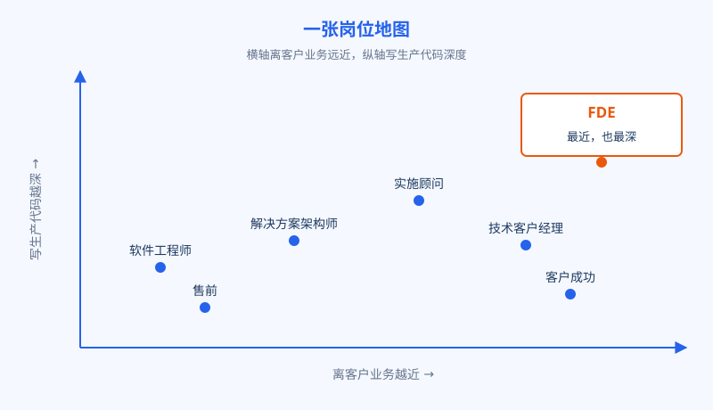
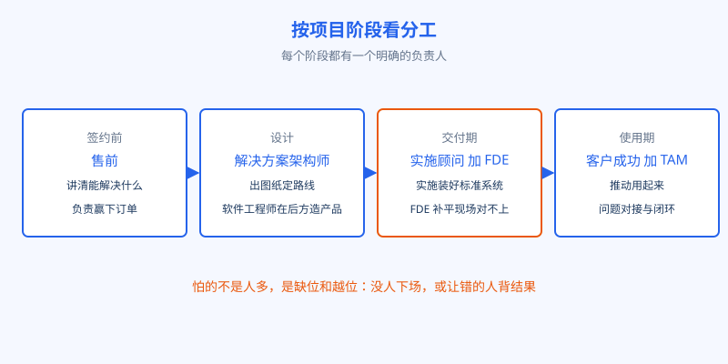

# 第 2 章 一张岗位地图

## 开场

临江精工的项目启动会上，来了七八个人，头衔一个比一个像：厂商的售前顾问、实施顾问、客户成功经理，加上陆远这个 FDE，还有临江精工自己的信息化工程师。厂长听完一圈介绍，问了一句很实在的话：以后系统出了问题，我到底找谁？没人抢着回答。这不是厂长不懂行，而是这些岗位本来就长得像，分工又常常说不清。这一章把这张岗位地图一次画清：谁干什么、谁对什么负责、出了事找谁。

## 白话讲解

先给每个岗位一句人话。软件工程师在产品方内部写产品，服务的是成千上万个客户，一般不进某一家客户的现场。解决方案架构师负责出图纸：系统怎么搭、模块怎么分、用什么技术路线，他出方案，但通常不亲手把代码写进客户的生产系统。售前在签约之前工作，任务是讲清产品能解决什么问题、做演示和验证，帮公司把单签下来。实施顾问在签约之后进场，按既定方案把标准产品装好、配好、教会客户用，强项是熟悉产品和交付流程。客户成功管的是用起来之后的事：推动客户真正用上产品、盯续约和口碑。技术客户经理偏支持和协调，系统日常运行中的问题由他对接、跟踪、升级处理。

FDE 呢？他是签约之后进场、但不止于「装好配好」的那个人。他要钻进客户的真实业务和老系统里，写生产代码，做定制集成，把产品和客户现场之间所有对不上的地方一一补平，并且对「业务到底有没有变好」这个结果负责。

把七个岗位放在一张图上，差别立刻清楚：横轴是离客户业务的远近，纵轴是写生产代码的深度。FDE 在右上角，离业务最近，代码也写得最深；其他岗位各有自己的格子，谁也不该被硬拉到右上角去。

图：岗位地图：每个岗位都有自己的位置，FDE 的位置是离业务最近、代码最深。

再换一个角度看分工，按项目的时间顺序排：售前负责「能不能做、值不值得买」，实施顾问负责「按方案装好配好」，FDE 负责「在现场把对不上的全补平、把结果做出来」，客户成功和技术客户经理负责「长期用得顺、问题有人管」。软件工程师在后方造产品，解决方案架构师在中间出图纸。一个健康的项目，这些角色都该在场，怕的是缺位和越位：让售前承诺交付，让实施顾问背业务结果，让 FDE 长期当客服，都是常见的错位。

图：按阶段看分工：每个岗位在项目时间轴上守自己的一段，交接处最容易出空白。

| 岗位 | 主要阶段 | 核心产出 | 对什么负责 |
|---|---|---|---|
| 软件工程师 | 产品研发 | 通用产品 | 产品质量 |
| 解决方案架构师 | 售前与设计 | 技术方案 | 方案合理性 |
| 售前 | 签约前 | 演示与验证 | 赢下订单 |
| 实施顾问 | 交付期 | 上线的标准系统 | 按方案交付 |
| FDE | 交付期 | 跑进业务的生产系统 | 业务结果 |
| 客户成功 | 使用期 | 使用深度与续约 | 客户用得好 |
| 技术客户经理 | 使用期 | 问题闭环 | 运行稳定 |

实际工作中最容易混的是两对。一对是实施顾问和 FDE：两人都出现在交付期，都进客户现场，区别在遇到图纸之外的问题时怎么办。实施顾问的标准动作是记录下来、反馈回去、等方案更新；FDE 的标准动作是当场判断、当场改、当场对结果负责。另一对是解决方案架构师和 FDE：架构师的价值在全局和长远，图要经得起三年后回看；FDE 的价值在当下和落地，方案再好也要先回答「这周能不能跑起来」。把这两对分清，岗位地图就基本不会用错。

还有一条隐线值得点明：这张地图不是职级图。FDE 不是比实施顾问「高级」，客户成功也不是售后的附属。每个岗位的不可替代性来自它站的位置：售前懂客户为什么买，实施懂产品怎么装，FDE 懂现场为什么跑不起来，这三种知识很少长在同一个人身上。用错人的代价，往往比缺人更大。

## 陆远的现场

还是启动会之后那一周，陆远第一次带着售前顾问和实施顾问一起去产线。分工在路上就说好了：售前顾问负责向厂长解释清楚方案的边界，哪些问题这次解决、哪些不在范围内，免得后面期望失控；实施顾问拿着清单核对部署环境，服务器、网络、账号权限一项项落实；陆远不参加务虚的部分，他直接跟着王工下产线，看质检员怎么判废品，把 MES 里最近三个月的缺陷记录导出来，当场发现演示数据里的缺陷分类和产线实际用的口径有两类对不上。回会议室后他把这个问题摆到桌面上，项目计划当场改了一处：第一周先对齐分类口径，再谈模型。这一幕就是岗位地图的实地版：售前管期望，实施管环境，FDE 管那些图纸上写不出来、只有钻进现场才看得见的对不上。

## 翻车现场

有一家公司上数据平台，请了很强的架构师，方案做得漂亮：图分了七层，每个模块的边界都画得工工整整。半年过去，图纸改了四版，系统却没上线，因为没有一个人负责把平台和公司的老系统真正接起来：接口谁来写、历史数据谁来清洗、出了脏数据谁来兜底，全在职责的空白地带。架构师说自己只负责设计，实施团队说图纸没写这些细节，业务部门等得发火。最后公司不得不临时高价找来能下场写代码的人救火。教训很直白：岗位地图上最容易空出来的，就是右上角那格。出图的人再多，也替代不了下场把活做完的人；签项目时先把每个格子由谁坐、出了问题谁拍板写进责任表，比多开十次会都管用。

## 要点回顾

- 七个岗位按阶段和职责分工：售前赢单，实施交付标准系统，客户成功管使用，技术客户经理管运行。
- FDE 的位置独一份：离客户业务最近，写生产代码最深，对业务结果负责。
- 常见的病不是能力不行，而是缺位和越位：没人下场写集成代码，或让错的人背结果。
- 启动项目时先画责任表：每个环节谁负责、出了问题找谁，白纸黑字。

## Kata

1. 把你公司里最接近这七个岗位的人对号入座，看看哪一格是空的，哪一格坐了两个人。
2. 「出了问题找谁」这个问题在你的项目里有明确答案吗？如果答案是「开会再定」，风险会出现在哪里？
3. 假设预算只够多招一个人：业务线天天催上线，老系统集成没人做，你会补哪个岗位？说说你的判断依据。
