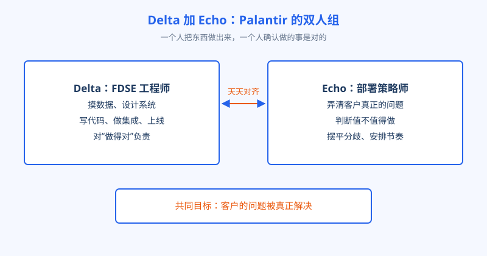
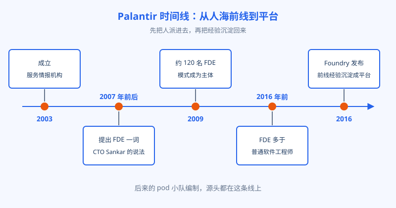

# 第 3 章 Palantir 发明了什么

## 开场

很多人第一次听到 FDE 这个名字，第一反应是：这不就是把工程师派到客户那儿吗，至于起个带军事味的名字？还真至于。这个岗位不是哪家公司营销部门想出来的时髦词，它是一家公司被客户逼出来的活法：客户的问题根本没法在会议室里问清楚，不把人派到现场，这活就没法干。这一章回到源头，看看 Palantir 到底发明了什么，后来者又抄对了什么、抄漏了什么。

## 白话讲解

Palantir 2003 年成立，起家客户是情报机构。这类客户有个特殊性：他们要处理的问题高度敏感，需求没法写成文档发给供应商，连开会讨论都要在特定的房间里。传统的软件生意在这里彻底失灵：你没法做用户调研，没法收集需求清单，总部的产品经理连客户的真实工作场景都看不到。Palantir 的解法简单粗暴：不猜了，把工程师直接派进客户的工作现场，坐在用户旁边，看他们每天怎么干活，现场理解问题，现场写代码，写完当场给用户试，不行马上改。

这个岗位在 Palantir 内部的全称是 Forward Deployed Software Engineer，缩写 FDSE。据其 CTO Shyam Sankar 的说法，forward deployed 这个词是他在 2007 年前后提出来的，借的是军队把部队部署到前线的说法，意思就是派到离问题最近的地方。

Palantir 内部给这个角色起的代号是 Delta，和它配对的还有一个角色：Deployment Strategist，代号 Echo，直译是部署策略师。两人的分工是理解这个模式的关键。Delta 是工程师，负责把东西做出来：摸数据、设计系统、写代码、上线。Echo 更像业务侧的搭档，负责弄清客户到底要解决什么问题、值不值得做、各部门的利益怎么摆平、项目推进的节奏怎么排。一个管「做得对」，一个管「做的是对的事」。后来很多公司学的 pod 小队编制，源头都在这里。

图：Palantir 的双人组：Delta 下场做系统，Echo 对齐问题与价值。

这个模式在 Palantir 不是点缀，而是主体。有两个数字可以说明分量：2009 年，公司已经有约 120 名 FDE；2016 年之前，FDE 的人数比普通软件工程师还多。一家软件公司，前线的人比造产品的人还多，这在当年是很难想象的组织形态。他们内部形容 FDSE 的工作像创业公司的 CTO：小团队，端到端，从和工程师讨论架构，到给客户高管汇报进展，全都自己扛。

也要看到这个组织形态的代价。前线人数比产品人数还多，意味着大量最强的工程师长期泡在单个客户那里，出差是常态，做的系统很多没法直接复用。这套打法能成立，靠的是两个前提：一是客户的问题足够重要、合同足够大，养得起这样的投入；二是后半段有平台来承接，让前线的辛苦不白费。缺了任何一个前提，照搬这套组织形态都会很贵。这是第 18 章和第 20 章会展开的判断，本章先把伏笔埋在这里：FDE 模式从来不是免费的午餐，它是把钱花在离问题最近的地方，前提是你算得过这笔账。

另外值得学的是 Palantir 对这个岗位的定级方式。他们没有把 FDSE 放在销售或售后序列里，而是当作工程师的主力序列来培养和晋升，工作内容被形容为像创业公司 CTO。这个定级决定了它能招到什么人：如果一家公司嘴上说要学 FDE，编制却挂在售后支持部门、薪资对标客服工程师，那它招来的不会是 Delta，只会是换了名片的驻场人员。第 22 章讲企业自建队伍时，这条还会再出现。

## 陆远的现场

陆远入职培训的最后一周只复盘 Palantir 的老打法，讲师拆出三条经验。第一，问题在现场不在文档：他到临江精工后第一周不待会议室，学的就是这条。第二，双人搭档：老潘是他队伍里的 Echo，验收口径和部门分歧由老潘冲在前面，他和小柯只管把系统做出来。第三，讲师反复强调：现场做的东西要回流。Palantir 早年每个客户一套定制系统，后来维护不动，才有了 2016 年的 Foundry，把反复用到的能力沉淀成产品，FDE 从此站在平台上交付。陆远在项目日志里留了一页「可回流清单」，把缺陷分类模板、老系统接口适配逐项记下，带回公司给产品团队。

图：Palantir 时间线：先靠人海前线站稳，再把前线经验沉淀成平台。

## 翻车现场

一家软件公司学 Palantir 学得很起劲：成立 FDE 部门，工程师大批派驻现场，口号、架构都抄齐了。三年后复盘，财务先发现问题：每个大客户一套系统，版本互不兼容，升一次级要挨家挨户改；工程师全陷在定制需求里，总部产品没人迭代，越做越弱。毛病出在哪？他们只抄了「派人去现场」，漏抄了后半段：现场经验回流成平台。a16z 提醒过这件事：只抄嵌入、不抄回流，会死在成千上万个无法维护的定制版上。Palantir 自己的解法就是 Foundry：前线照样深扎，但各客户的共性能力必须沉淀回平台，让下一次交付站在更高的起点上。学模式只学一半，往往比不学更贵。

## 要点回顾

- FDE 源于情报客户的特殊性：需求问不出来，只能派工程师进现场边看边做。
- Delta 与 Echo 是发明的核心结构：工程师负责做出来，部署策略师负责对准问题和价值。
- 2016 年前 Palantir 的 FDE 多于普通工程师，这个模式是公司主体，不是售后点缀。
- Foundry 说明了模式的后半段：前线经验必须回流沉淀成平台，只派人不沉淀会被定制拖垮。

## Kata

1. 为什么情报机构这类客户会逼出 FDE 模式？换成需求清晰、能写成文档的客户，这个模式还划算吗？
2. Delta 加 Echo 的分工里，Echo 干的活能不能让 Delta 兼任？说说兼任会在什么场景下出问题。
3. 如果你在的公司要学 Palantir，先学哪一半：派人进现场，还是建回流机制？给出你的顺序和理由。
