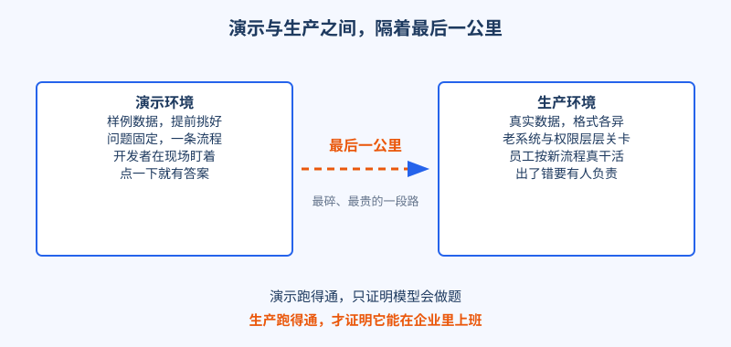
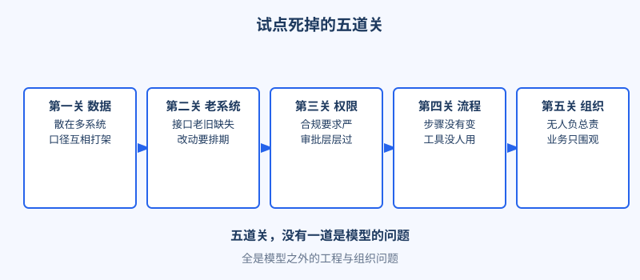
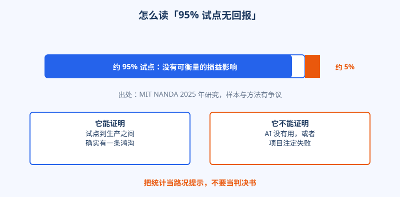

# 第 4 章 AI 的最后一公里

## 开场

一个 AI 助手在演示那天有多风光，第一次接上真实业务时就有多狼狈。

演示用的数据是提前挑好的，问题是提前写好的，点一下按钮，答案流畅地出来，会议室里一片点头。等真正上线，数据从各个角落涌进来：格式不一，缺字段，带着错别字和历史包袱。演示里从没出现过的情况，一个上午能来十几种。

这中间隔着一段距离，行话叫最后一公里。模型本身没有变坏，是它走到了真实世界面前。这一章先把这段距离看清楚：试点到底死在哪儿，那些吓人的统计数字又该怎么读。

## 白话讲解

最后一公里本来是物流词，说的是货到了城市仓库，送到每家每户门口这最后一段，路最碎，成本最高。AI 落地是同一个道理：模型在实验室里再强，也要走完数据接入、系统打通、权限审批、流程改造这最后一段，才能在企业里真正干活。

演示和生产，是两种完全不同的环境，对比一看就明白。

图：演示跑得通只证明模型会做题，生产跑得通才证明它能在企业里上班。

试点通常死在五道关上。第一是数据，散在多个系统里，口径互相打架，质量参差。第二是老系统，接口老旧甚至没有接口，改动要排期。第三是权限与合规，谁能看什么数据，要一层层审批。第四是流程，AI 给出答案之后，员工原来的工作步骤没有跟着变，工具再好也没人用。第五是组织，没人对结果负总责，试点挂在创新部门名下，业务部门只围观。

图：五道关没有一道是模型问题，全是模型之外的工程与组织问题。

这五道关还有个共同点：在演示阶段全都看不见。演示用的数据是现成的，不需要谈接入；演示跑在销售工程师的电脑上，不需要碰老系统；演示看的人都是拍板者，不需要走权限审批；演示不需要员工改变任何习惯；演示也不需要谁对结果负责，演完就散场。换句话说，演示是专门绕开了五道关的一场表演。它越是流畅，离生产反而可能越远，因为真正花时间的部分一处都没有碰到。

还有一个差别常被忽略：演示时出问题，代价是尴尬；生产时出问题，代价是停线、赔钱、丢客户。所以生产环境对稳定、留痕、回退的要求，和演示完全不是一个量级。很多试点不是死在做不出来，是死在没人敢签字让它按生产标准上线。

那句流传很广的「95% 的 AI 试点没有回报」，要这样读才准确。MIT NANDA 在 2025 年的研究称，约 95% 的企业生成式 AI 试点没有产生可衡量的损益影响。这个数字的样本和方法一直有争议，有人认为口径偏严，有人认为它只说明试点阶段的情况。它能证明的是：从试点到生产之间确实有一条鸿沟。它不能证明的是：AI 没有用，或者 95% 的项目注定失败。S&P Global 2025 年的调查是另一个角度：42% 的公司放弃了多数 AI 计划。两组数据放在一起，结论相同：难的不是开始，是走完。

图：把统计当路况提示，不要当判决书，它指出鸿沟的位置，不预言单个项目的命运。

## 陆远的现场

临江精工的质检加维修助手，就是一个卡在最后一公里的典型项目。

这个项目在厂里演示过不止一次，效果都很好，厂长当场拍板试点。半年过去，系统还停在演示状态，一次都没在产线上跑起来。

陆远接手前先看了一圈卡点：产线图片带着油污和反光，角度也和样例不同；零件编码 MES 一套、ERP 一套，对不上号；维修经验最全的王工，判断全在脑子里，变不成数据，纸质手册缺了好几年更新。每个卡点都不大，叠在一起，半年就过去了。

更麻烦的是，这半年没人喊停，也没人推进：厂里等供应商拿出能用的东西，供应商等厂里给数据、放他进产线。双方每月开一次会，会上都说在推进，会后各自等对方先动，试点就这样挂在半空。演示截图还挂在汇报里，产线上的人甚至不知道有这个系统存在。

临江精工缺的不是更强的模型，是有人走进现场，把这五道关一道一道拆开。怎么做是第三篇的主题，先把问题摆上桌面。

## 翻车现场

一家企业上线过智能客服，实验室里准确率很高。正式接流量后，真实工单涌进来：有方言，有错别字，有客户只发半句话就等回复。更要命的是，查订单要连的老系统没有现成接口，机器人只能回答「请稍等」，转人工比例比上线前还高。两周后项目被叫停，复盘结论写在报告第一页：拿演示的标准，验收了生产的东西。

错不在模型选错了，错在从第一天起就没有人去数那五道关。等上线才发现，等于把学费交在了最贵的时候。

## 要点回顾

- 演示跑得通，证明模型会做题；生产跑得通，证明它能在企业里上班。
- 试点之死大多与模型无关，死在数据、老系统、权限、流程、组织五道关。
- 95% 这类数字是 2025 年的调查口径，有争议，只用来说明鸿沟存在，不当铁律。
- 最后一公里的活，靠的是走进现场的人，不是再换一个更大的模型。
- 接手任何试点，第一件事是先数关，再谈模型：五道关逐项核对完，工作量才算估准。

## Kata

1. 找一个你见过的 AI 演示，按五道关逐项打分：哪一关在演示里被藏起来了？
2. 如果有人拿「95% 试点无回报」劝你别做 AI 项目，你会用哪三句话回应？
3. 给你手头的项目列一张卡点清单，按修复成本从低到高排序，第一项是什么？
