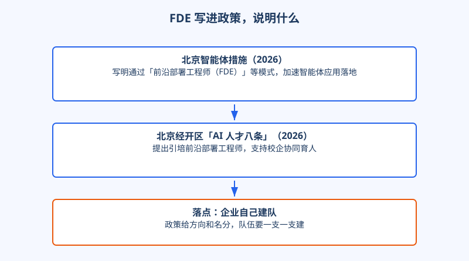
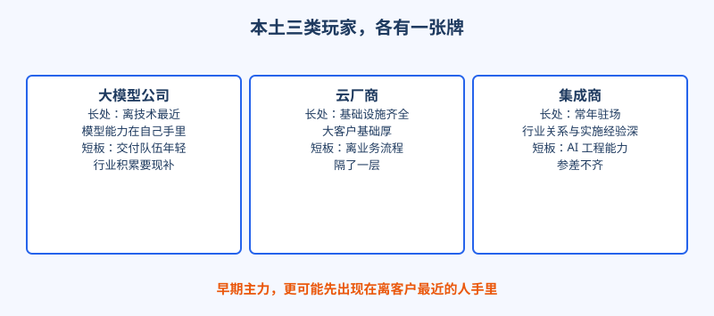
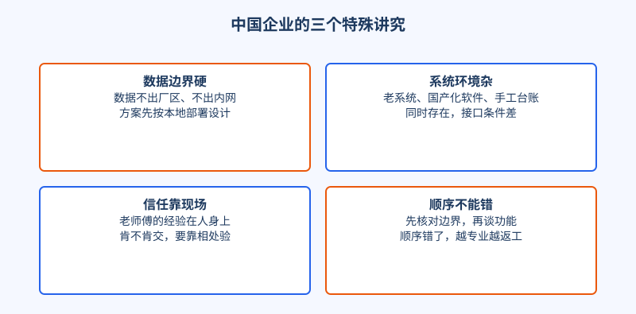

# 第 7 章 中国语境

## 开场

陆远接触国内客户时发现，开场白和海外案例里写的完全不一样。

海外 playbook 里，第一件事是谈场景和价值。到了国内工厂，厂长先问的往往是三个更靠前的问题：数据能不能不出厂，系统出了问题谁负责，老师傅们愿不愿意用。前两个是边界，第三个是人心。这三关过不去，后面的技术方案写得再漂亮也落不了地。

这一章把中国语境单独拿出来讲：政策在推什么，本土玩家会长成什么样，中国企业用 FDE 又有哪些特殊讲究。

## 白话讲解

先说政策信号。2026 年，北京市发改委等四部门印发的《北京市关于加快智能体引领发展的若干措施》，明确写了通过「前沿部署工程师（FDE）」等模式创新，加速智能体应用落地。注意，政策文件里用的译名是前沿部署工程师，和本书用的前线部署工程师是同一个岗位。北京经开区的「AI 人才八条」还提出引培前沿部署工程师、支持校企协同育人。一个岗位被写进政策和人才计划，说明它在中国已经过了要不要的问题，进入怎么建的阶段。

图：政策给的是方向和名分，真正的队伍还得企业自己一支一支建出来。

政策信号对企业还有一层实际作用：它给预算和编制提供了名分。很多企业的数字化负责人想组建这样的队伍，卡住的不是认识，是在内部立项时说不清这支队伍算什么、凭什么养。岗位有了正式名称，进了政策文件，写进人才计划，内部的论证就好做得多。海外的企业靠市场热度完成这一步，中国的企业往往要等政策把名分给定下来，这也是读政策要读到的一层意思。

再说本土玩家会长什么样。大概率还是三类人唱主角，只是各自的长短和海外不完全相同。

图：模型公司、云厂商、集成商各有一张牌，中国版 FDE 会先在离客户最近的人手里长大。

大模型公司离技术最近，但交付队伍普遍年轻，行业积累要现补。云厂商有基础设施和大客户基础，离具体业务流程隔了一层。集成商常年驻场，手里有各行业的现场关系和实施经验，短板在 AI 工程能力参差。按这个格局推断，中国版 FDE 的早期主力，很可能先出现在集成商和云厂商，再慢慢回流到模型公司。当然，这是基于公开现象的判断，不是已经发生的统计。

还有一类参与者在海外版图里不显眼，在中国却绕不开：高校和培训体系。经开区的政策专门写了校企协同育人，意思就是这个岗位的人很难全靠市场招，要从学校和在职工程师里成批地养。这条线见效最慢，但它决定了几年之后市面上到底有没有足够的人可用，第六章讲的供给缺口，在中国最后多半要靠这条线来填。

最后说中国企业的三个特殊讲究。第一是数据边界硬：很多企业要求数据不出厂区、不出内网，方案必须按本地部署和内网运行来设计，全云端的海外打法直接行不通。第二是系统环境杂：老系统、国产化软硬件、手工台账经常同时存在，接口条件比海外案例里写的更差，要给数据整理留足时间。第三是信任靠现场：老师傅的经验在人身上不在文档里，愿不愿意把经验交出来，取决于派来的人可不可信、肯不肯在产线边上待着。把这三条吃透，比多学两个框架重要。

图：边界、环境、信任，外加一条工作顺序，是中国现场的基本功。

## 陆远的现场

临江精工就是这三条的集中样本。

第一次碰方案，厂长先把话放在前面：产线图片和设备数据不出厂区，都跑在厂内网络里。陆远当场把依赖外部云服务的部分全部换掉，改为厂内部署。慢是慢了些，但边界先对了，后面才谈得上进度。

还有个细节，他在海外案例里没见过：系统清单拉出来，ERP 是多年前上的，MES 是另一个年份另一家公司做的，中间还夹着设备科自己维护的小工具和纸质台账。每个系统都有自己的负责人和脾气，谁也不敢轻易动谁的地盘。方案再合理，没先把这几方的关系理顺，接口就永远在「协调中」。

王工的态度是另一课。起初他对维修助手很冷淡，理由是「机器哪懂设备」。陆远没急着说服他，先请他挑毛病：助手答错的地方当场标出来。标着标着，王工发现这东西真能把他每次重复讲的基础问题接过去，态度才松动。信任不是谈出来的，是在产线边上一次一次验出来的。

## 翻车现场

一支团队把海外成熟方案整套搬到国内工厂：系统全在云上，工单流程按英文模板设计，上线清单列得整整齐齐。评审会上，信息部门只问了一句：数据出厂区，谁签字？全场沉默。方案回炉，光改部署架构和走审批就多花了两个月，工单字段也和工厂实际叫法对不上，返工了一大半。

错在把方案当成了可以平移的图纸。中国现场的边界条件和海外不同，第一步要核对的不是功能清单，是数据能不能动、人愿不愿用。顺序错了，越专业越返工。

## 要点回顾

- FDE 已被写进北京的智能体措施和经开区人才政策，中国语境进入建队阶段。
- 本土三类玩家各有长短，早期主力更可能出现在集成商和云厂商。
- 中国企业的三条特殊讲究：数据边界硬、系统环境杂、信任靠现场。
- 海外 playbook 可以学，但边界条件必须按本地情况重查一遍。

## Kata

1. 你所在的行业里，「数据不出域」这类边界还有哪些？列出三条，并说说它们会怎样改变方案设计。
2. 如果让你判断一家集成商有没有真 FDE 能力，你会看哪三个证据？
3. 面对一位不信任 AI 的老师傅，你的第一步会做什么？为什么不能先讲技术原理？
