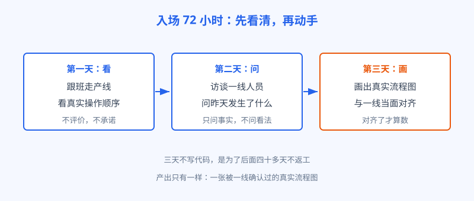
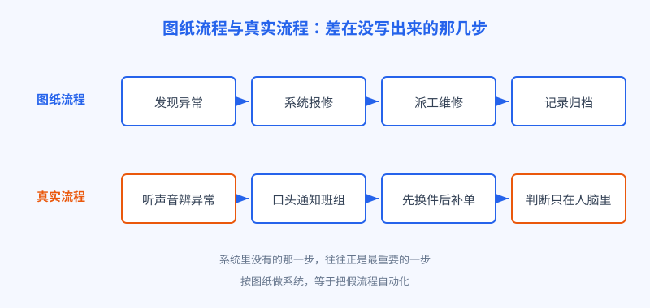

# 第 8 章 入场 72 小时

## 开场

周一早上八点，陆远带着小柯和老潘走进临江精工的大门。会议室里，上一家供应商留下的演示还在：样例图片一张张滑过，系统判断又快又准，厂长看完只说了一句，东西是好东西，就是上不了产线，你们要是能接上，条件好谈。

换成很多工程师，这时候已经打开电脑看代码了。陆远没有。他跟厂长要了三天：这三天不写代码，不看系统，先跟班、访谈、画流程图，三天之后交一张图，图对了，再谈工期。厂长有点意外，还是点了头。

这三天有个正式名字，叫入场摸底，英文说法是态势感知。说白了就是一句话：动手之前，先弄清自己站在什么地方。

## 白话讲解

新项目最危险的时刻，不是技术攻关，而是入场第一周。原因很简单：你手里所有的材料，都是别人整理过的。需求文档是管理层写的，流程图是几年前画的，数据是信息科导出的。每一份材料都干净、整齐、符合逻辑，而真实的工厂从来不是这样运转的。

拿着整理过的材料做设计，等于拿着旅游地图找巷子里的修车铺。地图没有错，只是它画的不是你要走的那条路。

所以 FDE 入场有一条铁律：先别写代码。72 小时只做三件事，看、问、画。

图：入场 72 小时只做三件事：看、问、画，产出是一张被一线确认过的真实流程图。

看，是跟班观察。坐在质检工位旁边，看一位质检员怎么完成一整班的活：手先摸哪里，眼再看哪里，什么情况停下来喊人。看的时候不评价，不纠正，更不急着说这个环节可以用 AI 优化。你一旦开始评价，对方就开始表演，真实动作就藏起来了。

问，是访谈一线。问法有讲究：不问看法，问事实。不问「你觉得质检有什么问题」，这种问题只能换来抱怨和场面话。要问「昨天最后一件返工的货，是因为什么」「上次设备半夜出问题，你先给谁打电话」。具体的事发生过，有细节，编不出来，也藏不住。

画，是把看到和问到的画成流程图，然后拿着图回到工位，请当事人逐段确认：这一步真是这样吗，下一步为什么走到那里。画错的地方，正是最有价值的地方，往往就藏着系统里不存在的真实环节。

还有一条规矩：摸底期间不许下结论，更不许当场许诺。三天里听到的问题，先记下来，归类，标上出处：谁说的，在什么场景下发生的，是亲历还是转述。等三天走完，把问题按出现次数和影响排序，再决定哪些进方案。三天就急着表态的人，往往在第一天就被某个声音大的个案带偏了方向，后面四十多天都在替那一个个案做系统。小队内部也在这三天分好工：陆远跟班和访谈，老潘负责把关键的人约到场、把会议的口径对齐，小柯不进会议室，先去摸数据和系统的底细。三个人看到的现场拼在一起，才接近全貌。

## 陆远的现场

第一天，陆远跟了质检班一整班。他很快注意到一个细节：图纸上的质检标准写得很清楚，划痕、磕碰、装配错位，每项都有图示。可质检员在灯光下翻看零件时，手上的动作比眼睛还多，很多件是先用指腹蹭一遍再举起来看。问了才知道，有些细微划痕眼睛看不见，手指能摸出来。这一条，任何文档里都没有。

第二天访谈维修班组，收获更大。设备科的王工陪着陆远找了几位老师傅聊天，其中一位干了二十多年，说起车间的减速机，话很实在：那台机器要出问题，提前半天声音就不对，闷，带点哨音，听惯了就知道。等系统报警，轴承早就烧了。

陆远顺着问下去：听出声音不对之后呢？答案是口头喊停，找班组长，先换件，单子后补。也就是说，工厂里最有价值的一次设备预警，靠的是耳朵、嗓门和二十年的经验，MES 系统里连一条记录都没有。图纸上的流程是发现异常、系统报修、派工、归档；真实流程完全是另一条线。

图：临江精工的报修流程，图纸一条线，真实一条线，差的就是没写出来的那几步。

第三天，小柯把两条流程并排画在白板上，老潘请王工和两位班组长来对图。对到维修那一段，几个人都笑了：原来大家都知道系统里那套流程是应付检查的，真出事没人走那条道。笑声过后，陆远在白板上圈出三个空白：听声辨异常没有记录，质检的手感判断没有标准，补单环节的数据经常隔天才录。这三处空白，就是后面方案必须正面回答的问题。

三天结束，陆远交给厂长的不是代码，是一张真实流程图和一页问题清单。厂长看完沉默了一会儿，说了一句：你们是第一批先问车间、再谈系统的人。

## 翻车现场

听一位同行讲过他们团队的教训。他们进场第一天就开工，依据是客户信息部门给的官方流程图和数据字典，三周时间把数据接口全做完了，联调时才发现数据对不上：系统里的时间戳大批集中在下午四点到五点。追查下去才明白，一线工人根本不按流程图操作，白天先干活，下班前集中补录，数据全是事后填的，顺序和时点都失真。

接口本身没有错，错的是它接了一个假流程。团队返工两周，更大的损失是信任：车间从此觉得这帮人根本不懂工厂，后面每次推广都要多费一倍口舌。入场时省下的三天，最后用三周还了回去，还搭上了利息。

## 要点回顾

- 入场第一周最大的风险，是拿着整理过的材料做设计
- 72 小时只做三件事：跟班看、访谈问、画图对齐
- 访谈一线只问具体事实，不问看法和评价
- 图纸流程和真实流程的差距，就是项目真正的难点清单
- 摸底的产出不是文档数量，是一张被一线点头确认的流程图

## Kata

1. 挑一个你最熟悉的业务系统，默写它的官方流程，再找一位一线使用者聊二十分钟，只问最近一次出问题的细节。对比一下，两条流程差在哪几步。
2. 把你手头项目的入场第一周排个计划：如果只能用三天摸底，你跟谁的班、访谈哪三个人、最后要画出哪一张图？
