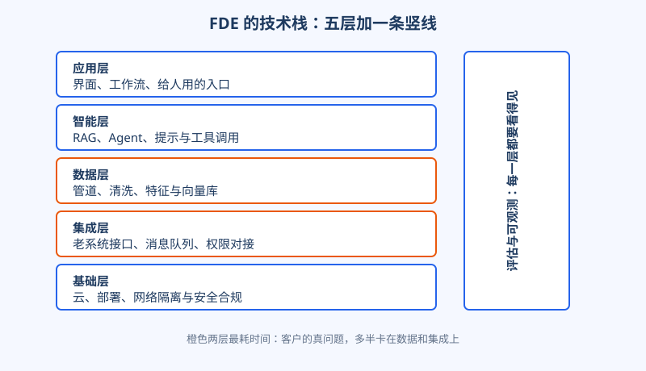
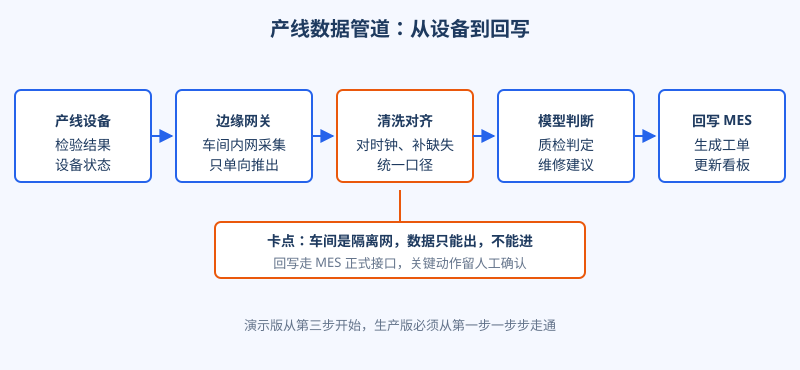

# 第 12 章 技术底盘

## 开场

陆远入驻临江精工的第三天，演示又跑了一遍。在会议室里，AI 质检加维修助手用样例数据回答得又快又准，厂长看得直点头。散会后陆远去车间，想把真实数据接进来看看，当场卡住：质检设备在车间内网里，和办公网物理隔离；MES 只开放了只读查询，写回工单的接口压根没有；设备导出的检验记录，时间戳还各走各的，有的快七分钟，有的慢三分钟。

这一课来得很及时：这个项目缺的从来不是模型，是模型底下那一整套接得通、跑得稳、看得见的功夫。这套功夫就是 FDE 的技术底盘。

## 白话讲解

外行看 FDE，觉得拼的是谁家的模型强。内行知道，模型只是五层里的一层。把一个 AI 系统在客户家里真正立起来，要过的关从下到上一共五层，旁边还得挂一条评估与可观测的竖线，缺哪层都到不了生产。

图：五层技术栈。越往下越不起眼，越往下越决定项目死活。

三句话把这张图说透。第一，演示版只需要上面两层做得像样：界面能点，模型能答。第二，生产版拼的是下面三层：数据进得来且口径统一，老系统接得上且权限合规，部署环境过得了客户的安全审查。第三，竖线决定你敢不敢上线：拿不出评估数据，就回答不了「它到底准不准」，验收时只能靠感觉吵架。

同样一件事，演示和生产的要求差多远，看这张表就够了：

| 功夫 | 演示版够用 | 生产版必须 |
|---|---|---|
| 写代码 | 笔记本上跑通的脚本 | 有测试、能回滚、别人能接手 |
| 数据 | 一份样例文件 | 管道自动跑，断了有人知道 |
| 模型调用 | 答对几个典型问题 | 有评估集，改一版量一版 |
| 集成 | 手工导一次数据 | 走正式接口，权限最小化 |
| 运行 | 在自己电脑上开着 | 有日志、有告警、能定位故障 |

竖线值得单独多说两句，因为它最容易被当成可选项砍掉。评估的做法不玄：从客户的真实历史数据里抽出一批有标准答案的样本，攒成评估集，之后每改一版提示、每换一个参数，先在评估集上跑出分数，再决定要不要上线。可观测则是三件套：关键调用留完整日志，判定量和异常率做成看板，超过阈值自动告警。没有这两样，系统出了问题你只能听用户说「感觉最近不准」，连坏在哪一层都定位不了。

基础层里最容易低估的是安全合规这一关。在客户的规矩里，账号权限要最小化，敏感数据要脱敏，操作要留审计记录，这些不是加分项，是入场审查时的一票否决项。很多演示做得很好的项目，最后就死在这一关上：方案什么都好，就是过不了客户 IT 部门的安全评审。

所以 FDE 的技术选型有个朴素原则：每一层都用客户现场能过审、能运维的方案，而不是自己最顺手的方案。在别人家里写代码，第一标准是活得久，第二标准才是写得漂亮。

## 陆远的现场

临江精工的网络隔离，是陆远这周的主战场。厂里的规矩很硬：车间内网不许连外网，一条数据都不许往外发，理由也充分，产线停一小时的损失比什么都大。

陆远和小柯没有去申请破例，而是顺着规矩设计。小柯在内网放了一台边缘网关，只做一件事：把检验数据按约定格式单向推出隔离网，推的方向反过来不成立。模型服务放在办公网侧，处理推出来的数据。判定结果要回写 MES，走的是厂里正式开放的接口，而且关键动作加了一道人工确认：系统建议开维修工单，值班工程师点确认才真正生成。

图：从设备采集到回写 MES 的五段管道，卡点在隔离网和数据清洗。

管道通了，第二个坑是数据质量。三台质检设备的时间戳对不齐，同一件零件的加工记录和检验记录拼不到一起；还有近两成的检验记录缺了操作员字段。两人花了两天做清洗规则：统一校时、缺失字段标成待补而不是猜一个填上、异常值单独进一个队列人工看。做完这一步，模型判定才第一次有了可信的输入。这也印证了分层图里那句话：数据层和集成层，才是 FDE 真正耗时间的地方。

上线前最后一周，陆远补的是竖线。他和王工一起，从过去三个月的真实检验记录里挑出八百多条有定论的样本，做成评估集：此后每次调整判定规则，先跑评估，漏检和误报两个数都盯着，变差就不许上线。同时他给厂里留了一块运行看板：当天判定了多少件、多少件转人工、管道有没有断流，值班工程师一眼能看出系统是不是健康。验收那天，厂长问的第一个问题就是判定准不准，陆远直接把评估报告翻给他看，数字摆在那里，比任何解释都有力。

## 翻车现场

有一支团队给一家零售客户做智能补货助手，演示惊艳：问一句就给出每个门店的补货单。签了约上线，第一天晚上就被连夜下线。原因不在模型：他们的程序直连生产数据库，每算一次补货就全表扫一遍销量数据，赶上晚高峰，把收银系统拖到结账排长队。门店投诉电话打爆了值班室，项目组只能先关停，第二天再谈。

错在哪？把集成当杂活。演示环境数据量小、没人同时用，怎么连都没事；生产环境里，你的程序和人家吃饭的系统共用一台数据库，一次全表扫描就是一场事故。后来救回来靠的是三件笨事：改读只读副本、给查询加限流、先上一家门店灰度一周。技术上没有新意，全是底盘功夫。

## 要点回顾

- FDE 的技术底盘是五层加一条竖线：应用、智能、数据、集成、基础，评估与可观测贯穿全程。
- 演示拼上面两层，生产拼下面三层，项目死活大多由不起眼的那几层决定。
- 在客户家里做技术选型，第一标准是能过审、能运维、活得久。
- 数据清洗和系统集成不是配角，是 FDE 工时的大头，要提前留足时间。
- 上线前必须能用评估数据回答：它到底准不准，坏的时候我知不知道。

## Kata

1. 拿你手头的一个项目，按五层各写一句现状，找出最薄的一层，并说明它会在上线时怎么发作。
2. 假设客户的网络完全隔离，设计一条单向数据通道：哪些数据可以出，哪些坚决不出，出问题谁负责？
3. 给你的系统列一张上线前评估清单：至少写出三个必须用数字回答的问题，比如判定准确率、响应时间、故障发现时间。
