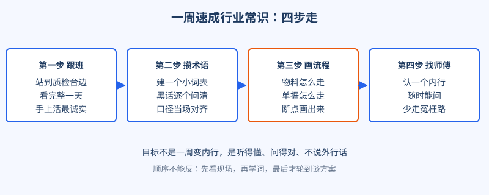
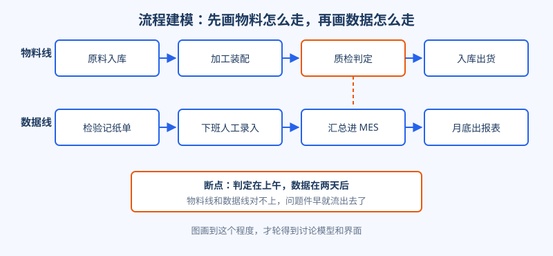
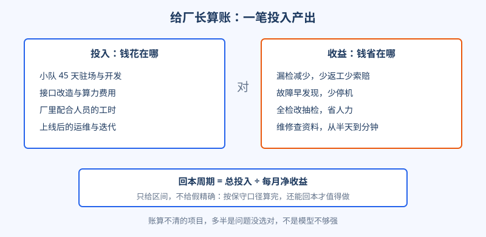

# 第 13 章 业务嗅觉

## 开场

陆远第一次下车间，闹了个笑话。他指着质检台问：「这个检具测的是哪一批？」质检组长抬头看了他一眼，没说话。后来王工悄悄告诉他：检具就是测零件合不合格的那套量具，这是车间里最基本的词，他问得像个纯外行。更麻烦的是口径：他汇报时说不良率百分之三，组长当场纠正，这里说的是每班的下线不良，里面还混着返修后合格的件，两个数根本不是一回事。

那天晚上陆远想明白一件事：在工厂里，代码写得再好，听不懂人家的话，连问题都问不对。业务嗅觉不是锦上添花，是入场券。

## 白话讲解

业务嗅觉拆开就三件事：听得懂、画得出、算得清。

听得懂，是术语和口径。每个行业都有一套黑话，黑话背后是人家几十年沉下来的经验分工。速成有章法，一周之内做完四步，顺序还不能反。

图：速成四步。先看现场再学词，先学词再谈方案。

画得出，是流程建模：把物料怎么走、单据怎么走画在同一张纸上。两条线一对，断点自己就跳出来了。临江精工的断点很典型：零件上午就判了不合格，检验数据却靠纸单下班后录入，问题件在被发现之前早流到下一道工序去了。

图：物料线与数据线的时间差，就是质检助手的第一个用武之地。

画流程有个笨办法，但特别管用：跟着一件实物走完全程，每到一步问三句话：这一步谁来做，凭什么判断合格不合格，结果记在哪里。前两个问题问的是工艺，第三个问题问的是数据。多数项目的断点都出在第三问上：事有人做，判断有标准，唯独结果记在纸上、记在某个人脑子里，或者记在第二天才补录的表格里。

算得清，是给决策者算投入产出。注意不是算给技术人员看的账，而是算给拍板的人看的账：花在哪、省在哪、多久回本。

图：一笔账的算法。先算省下的，再算花掉的，最后算回本周期。

算账时还有个分寸：收益要分硬软。漏检减少省下的返工和索赔，是能进财务报表的硬收益；员工少加班、老师傅少被半夜叫起来，是真实存在但不好入账的软收益。汇报时两者要分开说，软收益只做补充。把软收益当硬收益算，是新手最常见的翻车点，拍板者都是老江湖，一眼就看出来，从此你报的所有数都会被打折。

最后还有一件小事，影响却很大：把技术话翻译成人话。同一页汇报材料，两种说法，效果天差地别。

| 技术说法 | 人话说法 |
|---|---|
| 提高召回率 | 一百个坏件，能多抓住几个 |
| 降低推理延迟 | 工人点完按钮，少等几秒 |
| 置信度低于阈值转人工 | 拿不准的件，自动交给老师傅看 |
| 做数据清洗 | 先把账对齐，错的数据不进系统 |

## 陆远的现场

这一周陆远给自己排了满课。白天跟着王工站班，看零件从上料到判定走完的全程；小本子记术语，检具、首件检、巡检、让步接收，一个个问清，攒下六十多个。口径拿不准，先问王工这个师傅。

他把术语本整理成共享对照表，发给团队和厂里对接人，新人开会前先看。别小看它：省下的是反复解释的成本，也避免了两边用同一个词说两件事这种最隐蔽的误会。

算账之前先对口径：返工成本按人工加材料算，不摊管理费；停机损失按产线班产值算，不按订单总额算。口径对齐，数才经得起追问。

周末他给厂长做短汇报，不讲模型，只讲一笔账：每月多少返工、多少客诉索赔，项目要花多少，驻场、接口改造、厂里配合的工时都算进去。按保守口径给区间：漏检只降一半，大约两个季度收回投入。厂长听完第一个问题是：第二条产线的数据什么时候能一起接进来？这笔账算通了，比十页技术方案都管用。

## 翻车现场

一支团队给一家机构做文档助手，评审会上全程大词：大模型、向量库、智能体。轮到一线业务负责人提问，三个问题都答不上来：每天处理多少份文档，高峰期在什么时候，出错一份代价是什么。团队一个数都说不出：从没跟着业务员坐过一天，工作量全靠想象估。

错在哪？用技术逻辑代替了业务逻辑。方案在评审会当场被搁置，理由很实在：连我们一天干多少活都不知道，做出来的东西谁敢用。后来这支团队回炉一周：跟班、数单量、画流程，再回来谈方案，同一批评审顺利通过。技术方案一个字没改，改的是对业务的理解。

## 要点回顾

- 业务嗅觉是入场券：听得懂、画得出、算得清，缺一样都会在现场露怯。
- 行业速成四步：跟班、攒术语、画流程、找师傅，顺序不能反。
- 流程建模要画两条线：物料怎么走、数据怎么走，断点在对不上的地方。
- 给拍板者算账，只给区间和保守口径，假精确最伤信任。
- 汇报时先说人话：对方关心的是少返几次工、少停几小时机。
- 速成到位的标志不是词都认识，是一线的人愿意把真话告诉你。

## Kata

1. 挑你最熟悉的一个系统，写出五个内部术语，再逐个翻译成人话，给完全不懂行的家人念一遍，看对方能不能听懂。
2. 给你手头的项目算一笔粗账：投入列三项，收益列三项，按保守口径估回本周期，并写明每个数是怎么来的。
3. 找一段你亲历的业务流程，画出物料线和数据线两条线，标出你认为最值得先动手的断点，并说明理由。
