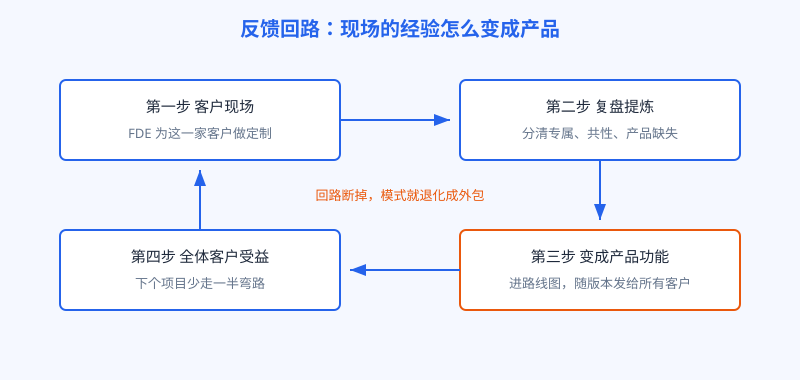
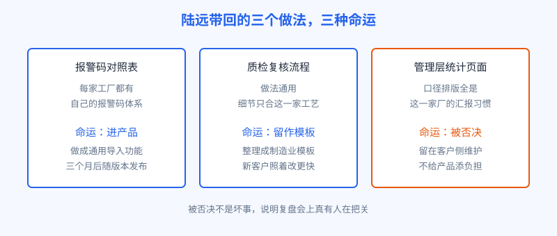

# 第 16 章 现场变产品

## 开场

项目验收那天，厂长请陆远一行人吃了顿食堂。饭桌上气氛很好，可陆远心里清楚：真正的考试在回总部之后。45 天里，他们为临江精工写了不少只适合这一家工厂的代码。这些代码如果留在客户的服务器上慢慢老化，这个项目就只是一次做完的外包活。如果能把其中的共性提炼出来，变成产品功能，下一个客户就能少走一半弯路。

FDE 模式能不能成立，分水岭就在这里：现场做的事，有没有一条回到产品的路。

## 白话讲解

先说一个简单的比方。开连锁面馆的师傅去一家店驻店，发现这家店的客人爱吃辣，于是临时加了一勺辣椒油。如果这件事到此为止，它只是一次临场发挥。如果师傅回总部复盘，发现十家店里有八家都缺辣口选项，把它写进菜单和后厨流程，这次驻店才变成了公司的资产。

FDE 在客户现场做的工作也一样，分三层。最底层是只属于这家客户的特殊处理，比如对接它独有的老系统，这类东西注定留在现场。第二层是同类客户都会遇到的共性问题，比如制造业都要把设备报警码和维修手册对应起来，这类做法可以提炼成模板和组件。第三层是产品本身缺失的能力，一旦补上，所有客户都受益，这类必须进产品路线图。

判断属于哪一层，只问两个问题。第一，别家客户会不会遇到同样的问题。第二，把它做成通用功能，成本是不是比分头定制更低。两个都是是，才值得回流。

图：现场定制经过复盘提炼，变成产品功能，再帮到全体客户，这条回路是 FDE 模式的核心资产。

回路转起来的前提，是公司有一套复盘机制：每个项目结束，FDE 要交一份现场报告，写清做了哪些定制、哪些别家也会遇到、建议产品怎么接。产品团队要有人专门接这份报告，并且有权力排期。少了任何一环，回路就断在半路。

复盘的节奏也有讲究。不要等项目全部结束才复盘，那时细节已经忘了一半，工程师也已经奔向下一个客户。更好的做法是双层节奏：驻场期间每周留半小时，把本周遇到的新问题和临时解法记进一份活文档；项目结束时再开正式复盘会，只讨论已经记下来的东西，不靠回忆。还有一个细节常被忽略：复盘会要请下一家同类客户的负责人在场旁听。哪些做法能直接复用，让下一个项目的人自己判断，比转述一百句都管用。回路转得快不快，看的不是报告写得多厚，是下一个项目真正少走了多少弯路。

a16z 对 FDE 热潮的提醒，恰恰说的是这件事。他们说，只抄嵌入这个动作、不抄经验回流的公司，最后会死在几千个无法维护的定制版上。每个客户一套改法，升级一次产品，要同时改几千处代码，谁也扛不住。

图：陆远从临江带回的三个做法，一个进了产品，一个留作模板，一个被否决。

## 陆远的现场

陆远的复盘报告里，列了三个最有代表性的定制做法。

第一个是报警码对照表：临江的报警码上千个，老师傅靠经验知道每个码对应哪类故障，陆远和小柯把报警码、故障现象、维修手册章节做成对照，助手回答时先查表。复盘会当场认可：每家制造企业都有自己的报警码体系，于是做成通用的导入功能，客户填自己的表，产品负责检索和引用。三个月后进了正式版本。

第二个是质检照片的判定流程：留样、复核、人工确认后回写。它太依赖临江的工艺细节，进不了通用产品，但可以整理成制造业模板，新客户照着改，比从零快得多。

第三个被否决了。陆远给临江管理层做过一个统计页面，口径和排版全按这一家的汇报习惯。产品团队判断很直接：单个客户的报表需求，别家用不上，进产品只会给维护添负担，留在客户侧由临江工程师维护。陆远起初有点不服，后来想通了：被否决不是坏事，说明真有人把关。什么都往产品里塞，产品会胖得走不动路。

## 翻车现场

一家软件公司学 FDE 打法，工程师驻进大客户，客户提什么改什么，半年改了两百多处，客户满意，续约也签了。问题出在第二年大版本升级：定制散落在十几个客户的部署里，没人说得清每处为什么改、影响什么。升级拖了五个月，最后只能宣布老客户停在旧版本。这家公司等于同时养着十几个版本，维护成本翻了几倍，当初靠定制赢来的收入，又被维护吃了回去。

翻车的原因不在工程师不努力，而在公司从没建复盘和回流的环节。定制只进不出，现场的经验永远变不成产品的能力。

## 要点回顾

- 现场定制的价值不在交付本身，在于能不能回流成产品。
- 定制分三层：客户专属的留现场，行业共性的做模板，产品缺失的进路线图。
- 判断标准只有两个问题：别家会不会遇到，做成通用的是不是更便宜。
- 复盘机制要落到人和流程：FDE 必须交现场报告，产品侧必须有人接、有人排期。
- 被否决是正常环节，没有把关，回路就会被垃圾定制堵死。

## Kata

1. 回想你手头最近一个项目，列出三处为单个客户做的特殊处理，试着把它们分进本章的三层，并说明理由。
2. 如果你是产品负责人，收到一份有八条回流建议的现场报告，你会用哪三条标准筛掉其中一半？
3. 找一个你熟悉的产品，观察它有没有「一看就是给某个大客户定制」的功能，想想这类功能对其他用户是资产还是负担。
