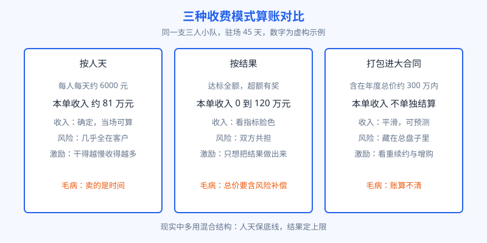
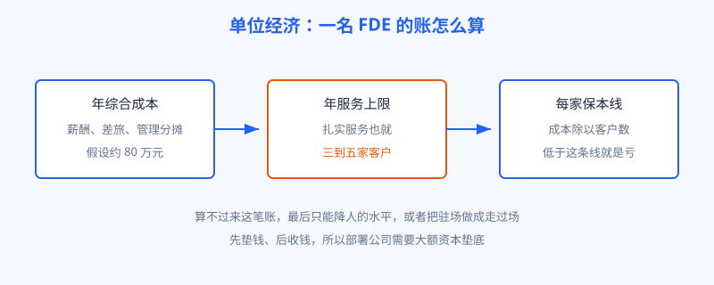

# 第 17 章 怎么收费

## 开场

陆远的项目验收之后，老潘被销售拉去开了一个内部会，主题只有一句话：这一单到底赚没赚钱。财务把账摊开：驻场 45 天，三个人的人力成本、差旅、再加上售前阶段投入的时间。会议室里安静了一会儿。项目做成功了，不等于这笔生意做成功了。FDE 是重人力、重现场的打法，收费方式定错了，做得越成功，亏得越多。

这一章把三种主流收费方式的账，一笔一笔算清楚。

## 白话讲解

第一种，按人天收费。派几个人、驻多少天，按天结账，逻辑和律师按小时计费一样。好处是收入确定，客户也容易理解。坏处是客户天然会盯着你的人在做什么，今天少一个人、多休一天，都要来问。更深的问题是：按人天卖，卖的是时间，FDE 干得越利索、问题解决得越快，收入反而越少。

第二种，按结果收费。事先约定可衡量的目标，比如质检漏检率降到某个数以下、上线时间达到约定日期，达标拿全额，超额有奖励，没达标打折。好处是双方目标一致，客户买的不是工时是结果。坏处是结果受很多外部因素影响，设备老化、业务部门不配合，都能拖住进度，厂商要承担更大的风险，所以总价通常更高，作为风险补偿。

第三种，打包进企业大合同。FDE 服务不单独标价，和软件许可、云资源、年度支持打包成一笔总价，签一年甚至多年。微软、OpenAI 这些大厂的新部署公司多用这种结构：客户买的是一个整体方案，驻场工程师是方案的一部分。好处是收入平滑可预测，客户也不必为每次派人单独走采购。坏处是账算不清，到底哪部分是软件的钱、哪部分是人的钱，几年后想拆开谈续费，双方都是一笔糊涂账。

图：同一支三人小队、同一个 45 天项目，三种收费方式下收入和风险完全不同，数字为虚构示例。

为什么 OpenAI 的部署公司一成立就要募集超过 40 亿美元、Anthropic 的合资公司资本约 15 亿美元？因为按结果和打包这两种模式，都要求厂商先垫钱：工程师先派出去，收入要等项目见效、等合同周期慢慢收回。垫资能力就是门槛，这也是部署生意从一开始就是大玩家的游戏。

再说单位经济。一名成熟 FDE 一年能扎实服务的客户，掰着指头数也就三到五家。他的薪酬、差旅、管理成本摆在那里，平均到每家客户头上，合同额低于某条线就是亏本。算不过来这笔账的公司，最后只有两条路：要么偷偷降低派驻工程师的水平，要么把驻场做成走过场。

图：一名 FDE 的年服务能力有限，单位经济就是把这条上限算进价格里。

## 陆远的现场

临江精工这一单的合同结构，是老潘参与谈的，最终用了混合结构：基础部分按人天，保厂商的成本底线；结果部分和两个指标挂钩，质检助手上线日期、维修问答被一线工人实际使用的比例。数字都不大，胜在口径清楚：上线日期看系统记录，使用比例看后台日志，双方不用吵架。

复盘会上算账，这个项目厂商侧只是微利。老潘的结论是：第一单不指望赚钱，它买的是三样东西，一份能进产品的现场经验（第 16 章那条回路）、一个制造业样板客户、一套下次能复用的报价模型。第二单开始，同类客户的驻场天数预计能压下来，结果部分的比例可以谈高，这笔账才真正转正。

这也是多数 FDE 生意的真实节奏：第一单交学费，第二单靠复用回本，第三单才开始赚钱。前提是学费真的换回了可复用的东西。

再说谈判桌上的一个常见误会。客户常觉得按结果收费对自己最安全：做不成就不付钱。其实不然。厂商为了对冲风险，会把总价定得更高，或者只挑最容易达标的指标来签；真正难啃但价值大的目标，反而没人敢碰。成熟客户的做法是把指标分成两层：一层是厂商完全可控的交付指标，比如按期上线、系统稳定性；另一层是双方共担的业务指标，比如一线使用率。前一层适合按结果付费，后一层更适合设成奖励而不是扣款。把风险切细了谈，双方才都不吃亏。

## 翻车现场

有一家公司为了拿下一家大客户，签了纯按结果的合同：系统上线并达到约定指标，一次性付全款。结果项目做到第十周，客户内部调整，原定的业务负责人换人，新负责人对指标口径有不同理解，验收一拖再拖。工程师驻在现场走不了，工资照发，款收不回，这家公司现金流当场吃紧，最后只能贱卖应收账款周转。

错在哪？不是按结果收费不好，是把全部收入压在单一结果、单一验收人身上，还没有约定中途变更口径时怎么算。收费结构里缺了保险丝：分阶段里程碑付款、指标口径白纸黑字、验收人变更时的处理办法，一样都没有。

## 要点回顾

- 按人天：收入确定，但卖的是时间，干得越快赚得越少。
- 按结果：目标一致，但厂商承担外部风险，总价必须包含风险补偿。
- 打包进大合同：收入平滑，但账算不清，续费时容易扯皮。
- 部署公司需要几十亿美元量级的资本，因为先进场、后收钱，垫资就是门槛。
- FDE 生意的节奏：第一单交学费，第二单靠复用回本，单位经济算不过来就只能降质量。
- 收费结构里要留保险丝：分阶段付款、指标口径写死、验收人变更时怎么办，缺一条都可能翻车。

## Kata

1. 给你所在的团队设计一个混合收费结构：哪部分按人天、哪部分按结果，结果指标选什么，为什么吵不起来？
2. 一名 FDE 年综合成本假设为 80 万元，一年扎实服务 4 家客户，每家至少要收多少钱才不亏？再想想，这还没算售前和管理分摊，加上之后是多少？
3. 如果你是客户，厂商提出纯按结果收费，你会高兴吗？站在你的立场，这种结构对你有什么隐藏风险？
