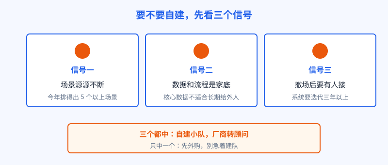
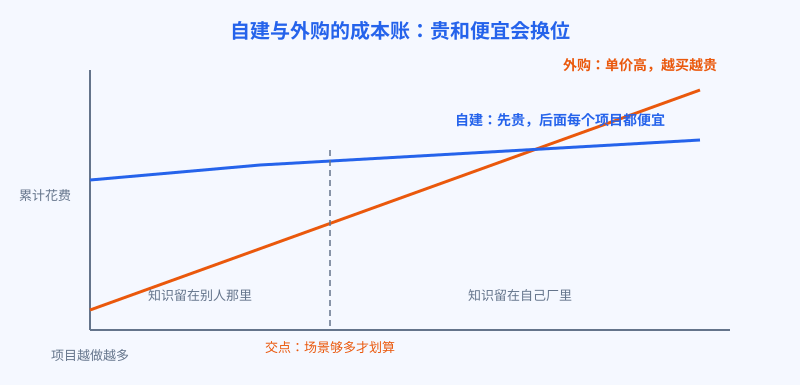

# 第 20 章 自建还是外购

## 开场

陆远撤场一个月后，临江精工的厂长把他请回去喝了一次茶。维修助手上线是上线了，可新问题一串：二号产线也想用，质检的规则改了两处，夜班师傅又提了三个小毛病。每一处都要改，每一改都要走厂商的排期和报价。厂长把一年的续约报价单推到陆远面前，问了一句话：这笔钱年年交，和我自己养一支小队，到底哪个划算？

这不是临江一家的问题。任何用过厂商 FDE 的企业，走到第二年都会撞上同一个选择题：继续买，还是自己建。这一章把这笔账算清。

## 白话讲解

外购像请名厨上门做席：手艺好，来得快，按桌结账。缺点也明显，厨子走了，菜谱没留下，家里人还是不会做。自建像培养自家厨师长：前期慢，要交学费，但手艺长在自己人身上，平时小改小动不用求人。

什么时候该自建，看三个信号。

图：决定自建之前，先对照三个信号

第一，场景源源不断。如果一家企业未来两年能排出的 AI 场景只有一两个，养一支队就是浪费，外购更划算。场景是一条流水线，队伍才有存在的意义。第二，数据和流程是家底。质检标准、工艺参数、客户名单这类东西，是企业的核心资产，让外人长期深度接触，风险会随时间累积。第三，系统要活很久。演示版可以买，上了生产、要迭代三五年的系统，必须有人在厂里长期接得住。厂商的人总要撤，撤走那天没有接班人，系统就开始慢慢死。

再算成本账。外购是按项目付费，单价高，但不用养人；自建是固定工资加培养成本，前期贵，之后每多做一个项目，边际成本就摊薄一截。两条线必然交叉，交叉点在哪，取决于场景数量。

图：场景越少外购越划算，场景越多自建越划算

| 对比项 | 外购厂商 FDE | 自建内部队 |
|---|---|---|
| 起步速度 | 快，现成的人和经验 | 慢，招人带人要半年 |
| 单个项目成本 | 高，按项目结账 | 低，主要是工资分摊 |
| 知识留在哪 | 厂商那里 | 自己厂里 |
| 对业务的理解 | 每次都要重新熟悉 | 天天在车间，长在日常里 |
| 主要风险 | 锁定、涨价、排期不受控 | 招不到人、队建歪了散掉 |

表：两种模式的账，要连知识这一项一起算

算账时还有三笔容易漏掉的隐性成本。一是等待成本：厂商的排期不在自己手里，一个小改动等三周，产线那边多停的、多绕的，都是钱。二是交接成本：每次换厂商的对接人，业务就要重新讲一遍，讲一次漏一点。三是涨价成本：系统越深地扎在人家的平台和人身上，第二年谈判桌上自己的筹码就越少。这三笔账不上报价单，但年年都在付。反过来，自建的隐性成本也要算清：队长的时间、给队员补课的半年、头两个项目必然交的学费。两边都算全，才叫算账。

操作上，接棒分三步走。第一步，买一段：试点期用厂商 FDE，但合同里就写明陪跑和知识转移的要求，人家干活时必须带着自己的人。第二步，建小队：陪跑期就是内部队的考察期和培训期，种子队员跟着厂商从头跑完一个项目。第三步，接棒：系统移交内部队，厂商转成顾问，按季度回访评审，不再按项目驻场。三步的顺序不能颠倒，没跟人跑过完整项目就直接自建，等于把学费交两遍。

最后记住一句话：内部队和厂商 FDE 不是替代关系，是接棒关系。厂商带来的是成熟打法和第一程的速度，内部队接的是长期留守和迭代。聪明的企业都分两段走：先买一段，学打法；再建队，接系统。Anthropic 把培训学院开到客户和伙伴那里，训的也是客户自己的人，道理相同：能力最终要长在客户身上。

## 陆远的现场

厂长让陆远帮着把账摆到桌面上。两人列了临江未来一年的场景清单：质检助手扩到二号产线、维修助手加夜班语音录入、仓库盘点、排产辅助、能耗看板，一共七个，个个都有明确的业务负责人。三个信号一对：场景够多，中了；质检和工艺数据是厂里的命根子，中了；已上线的两个系统要迭代至少三年，中了。三个全中。

结论很快定下来：自建一支四人小队，厂商合同改成顾问式，陆远每季度回访一次，帮着评审方案和带队长。厂长说了一句很实在的话：席可以继续请人做，但灶台得是自己家的。

还有一个细节值得学：临江没有一步到位先招满四人再说，而是先定队长、先跑第一个内部场景，跑通之后再补齐编制。理由是预算好批，人也看得准。先用半支队验证场景流水线真的转得起来，再扩编，比先把编制占满再找活干稳妥得多。信号是判断题，编制是分步走的，这两件事不要混在一起。

## 翻车现场

有一家做零部件的企业，试点成功后一冲动，三个月招了十二个人，挂出内部 AI 创新中心的大牌子。问题是场景没跟上：全年真正排得出的项目只有两个，队伍大半年在等活，最后被各部门借去做报表、做演示页。一年后复盘，厂里没人说得清这支队做成了什么，预算砍半，人走了一多半。错不在建队，在顺序：先有源源不断的场景，再有队伍；顺序反了，队伍越大，浪费越大。

## 要点回顾

- 自建之前先对三个信号：场景源源不断、数据是家底、系统要长期迭代。
- 成本账要把知识留存算进去，只比单价永远算不清。
- 内部队与厂商 FDE 是接棒，不是替代：先买一段学打法，再建队接系统。
- 场景清单排不出来，就先别建队。

## Kata

1. 给你的公司列一张未来两年的 AI 场景清单，要求每个场景写明业务负责人。列完数一数：够不够养一支最小的队？
2. 挑一个正在用外购服务的系统，算一算三年总账：服务费、每次改动的排期等待、厂商撤走后的接管成本，各占多少？
3. 如果只能中三个信号里的一个，你会因为哪一个信号决定自建？说清理由。
