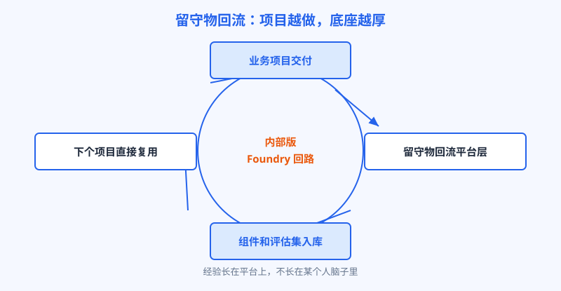
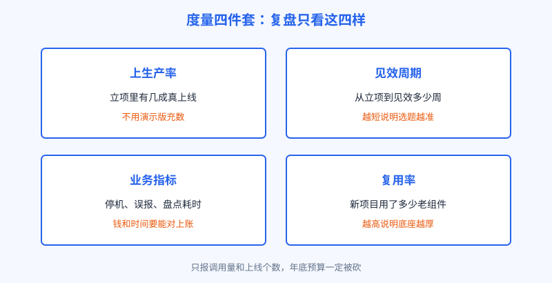

# 第 24 章 沉淀与度量

## 开场

内部队成立三个月，第一次季度复盘。厂长的问题很直接：四个人的工资、算力、软件钱，一个季度花了小几十万。做成的事我看得见，但明年预算会上，财务问我值不值，我拿什么回答？王工卡了一下。他手里有上线截图，有使用人数，就是没有一本能对上的账。

这一章讲队伍的下半场：做成的东西怎么沉淀成资产，价值怎么量成数字，人怎么一批批带出来。这三件事做不好，队伍干得再热闹，也过不了第二年的预算会。

## 白话讲解

第一件事，留守物回流。每个项目结束时，除了交付的系统，还要交四样东西回平台层：可复用的组件（比如接 MES 的数据模板、识别条码的视觉模块）、评估集（带标准答案的测试样本）、数据接入的规矩（字段口径、权限清单）、一份踩坑记录。这些东西统一入库，下一个项目先查库再动手。这就是 Palantir 当年把前线经验沉淀成 Foundry 的同一条回路，只不过搬到了企业内部：经验长在平台上，不长在某个人的脑子里，人走了，资产还在。

图：项目交付、留守物入库、复用提速，飞轮越转底座越厚

第二件事，度量。复盘只看四样，称为度量四件套：上生产率，立项的项目有几成真上了生产，分母要诚实，演示版不算；见效周期，从立项到业务指标动起来是几周；业务指标，每个项目立项时定的那本账，盘点耗时、停机次数、误报率，做完逐项对；复用率，新项目里有多少组件和评估集是直接拿老资产用的，这个数字涨，说明底座在变厚。

图：四件套里三样对业务，一样对底座，都不许注水

只报系统调用量、用户点击数这类热闹数字，是复盘大忌：它们涨得再快，也回答不了财务那句值不值。

第三件事，钱从哪出。预算有两种模式：中央买单，厂里统一养队，业务部门免费用；业务分摊，谁立项谁从自己预算里出钱。起步期多用前者，门槛低，队伍先证明自己；成熟后逐步转分摊，业务部门花自己的钱，才会认真选题、认真验收。

| 预算模式 | 好处 | 毛病 | 适合阶段 |
|---|---|---|---|
| 中央买单 | 立项快，队伍无后顾之忧 | 业务不珍惜，乱报场景 | 第一年，证明期 |
| 业务分摊 | 选题认真，账算得清 | 立项摩擦大，新部门不敢试 | 队伍站稳之后 |

表：多数企业走混合路线：第一个场景中央买单，后续项目业务分摊一半以上

## 陆远的现场

临江第一次复盘，王工交的账：三个月立项两个项目，仓库盘点上了生产，上生产率五成（另一个还在交付门前补样本，如实写了未上线）；盘点耗时从两人两天降到两人半天，账差笔数下降约四成；备件库复制盘点方案时，条码组件和评估集直接复用，省了约三分之一开发时间。账不算惊艳，但每笔都能查到出处。厂长看完说：就按这个口径，下季度起，业务部门的新场景走分摊。

同一季度，临江办起第一期训练营，学的是 Anthropic 的 Frontier Academy 的驻留制：集中训练加模拟考核，再用 12 周在自己公司带一个真实项目上线。临江缩小一号：从质检、设备、仓库三个部门选六名骨干，脱产集训一周，模拟题拿厂里去年的真问题做沙盘；之后每人回本部门带一个小场景，十二周，王工当教练，陆远每月回来评一次。结业标准只有一条：项目过移交门。第二批人的名单就这样长出来，扩编不再全靠外招。

回流还要有专人管，不然库会变成仓库。临江每月办入库评审，王工主持：新组件附带用过的项目和已知毛病，评估集标明来源和更新日期，过时资产打作废标记。入库不是存档，是上货架。再配一条硬规矩：新项目立项时，入场材料必须写明查过库没有、准备复用哪几样；写不出复用项的，要么真新问题，要么没查，评审会上说清。

结业那期，六人里四人带的项目过了移交门，两人延期：一个卡在数据补不齐，一个是业务负责人中途换人。王工没为好看放行，延期就写延期。这事传开后，第二期报名的人反而多了：这个证不是听课听来的，是真能换来本事的。沉淀、度量、带人，说到底是同一件事：让队伍的价值不依赖某一次汇报，而是摆在账上、库里和新人身上。

## 翻车现场

一支内部队年终汇报十分热闹：上线系统九个，调用量几百万次，幻灯片四十页。财务总监只问了一句：这九个，哪个让哪个部门少花了钱或者多赚了钱？全场沉默。原来六个是演示版，调用量大半来自内部测试。第二年预算会被砍，一点不冤。度量的作用不是汇报时好看，是提前替队伍回答那句值不值。等别人先问出来，队伍已经输了第一局。

## 要点回顾

- 每个项目交两份成果：能跑的系统，和能回流平台层的留守物。
- 度量四件套：上生产率、见效周期、业务指标、复用率，分母必须诚实。
- 预算走混合路线：先中央买单证明价值，再逐步转业务分摊。
- 带人用驻留制：集训加模拟考核，再用一个真实项目结业，队伍靠自己长人。

## Kata

1. 给你最近做完的一个项目列留守物清单：组件、评估集、数据规矩、踩坑记录，各写一条，缺的标出来。
2. 用度量四件套给你的团队打一次分：哪一项最拿不出手？它缺的是数据，还是本来就没做成？
3. 设计一期迷你训练营：学员从哪来、模拟考核用什么题、结业项目按什么标准验收，写成一页纸的方案。
