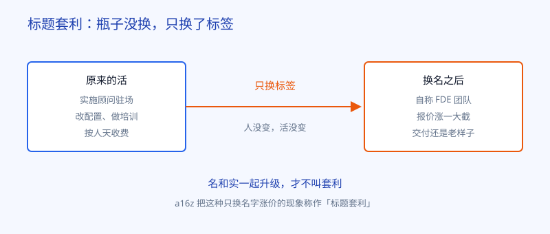
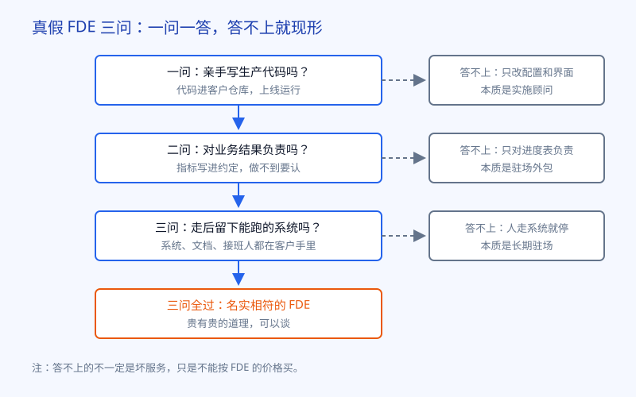

# 第 25 章 是不是换皮

## 开场

临江精工的项目上了生产之后，厂长有一次拿着一本宣传册问陆远：另一家公司也说自己派的是 FDE，报价比你们贵三成，册子印得比你们漂亮，我们凭什么信你们，不信他们？

这个问题问得很实在。2026 年之后，FDE 成了报价单上最值钱的三个字母。原来做实施的、做驻场的、做培训的，纷纷把团队改名叫 FDE，价格跟着往上走。买家坐在会议室里，看谁的名片都一样，根本分不出真假。

这一章就回答厂长的问题：FDE 里确实有一部分是换皮，但换皮不换皮，不看名片，看三件事。

## 白话讲解

先说一个词：标题套利。投资机构 a16z 在评论这波热潮时用过这个说法，意思和老话「新瓶装旧酒」差不多：一份工作本来有个朴素的名字，换上一个正当红的新名字，身价立刻涨一截，活本身却没有变。a16z 对 FDE 是两面看的，一面说它是当下最热的岗位，一面提醒这种换名涨价的现象真实存在。两句话要一起听。

图：瓶子没换，只换标签，就是标题套利；名和实一起升级，才是真本事。

那怎么分辨？不用看对方的宣传册，用三问就够了。这三问就是第 1 章立下的三个硬标准，换个问法摆出来：

图：三问判定法：一问写不写生产代码，二问对不对结果负责，三问走后留不留得下能跑的系统。

一问代码。真 FDE 亲手写代码，代码进客户的仓库，上线之后在生产环境里跑。只改配置、点界面、做培训的，是实施顾问，这份工作有价值，但不是同一份工作。二问责任。真 FDE 对业务结果负责，指标事先说清，做到了算数，做不到认账。只对进度表和交付文档负责的，是驻场外包。三问留守。人走之后，系统、文档、评估集和接班人都在客户手里，客户自己能接着跑。人一撤系统就停的，本质是长期驻场，客户买的不是能力，是依赖。

三问都过，贵有贵的道理。三问过不了，不是对方人品有问题，是这份服务不能按 FDE 的价格买。

这三问还有个用法：写进采购和合同里。招标时就把三问变成验收条款：代码提交到哪套仓库、业务指标写哪一个、交付清单里有没有文档和带教。敢把这三条写进合同的团队，至少对自己的活有底气；只肯在宣传册上写、死活不肯进合同的，答案已经摆在那了。验货的门槛从来不在技术，在于买方肯不肯在签约前多问这三句。很多企业不是分辨不出，是觉得问了显得不信任对方，面子上过不去。老潘有句话陆远一直记着：几百万的合同都签了，多问三句话的面子，能值几个钱。

## 陆远的现场

陆远没有直接回答厂长哪家好哪家坏，他把三问写在一张纸上，推回给厂长：下次对方来谈，您就按这个问，答案他们自己会说出来。

后来那家公司的人来临江精工谈二期，对方讲了四十分钟平台愿景，厂长问了一句：你们的代码进我们的仓库吗？对方说，我们有自己的交付平台，代码在我们那边更安全。厂长又问：检出率提不上去，算谁的？对方说，指标受很多因素影响，我们保证投入足够的人力。两问问完，厂长心里有数了，客客气气把人送走，回来跟陆远说：原来不用懂技术，也能验货。

回去的路上小柯问陆远，要是有一天咱们公司也只派实施、也挂 FDE 的牌子，你怎么办？陆远说，那我就先把三问拿来问带队的人，问不下去，我就不接那个项目。名片是公司印的，活是自己干的，最后客户记住的是谁把事情办成了，不是谁的头衔好听。这句话他说得很平静，小柯却记了很久。

陆远自己的小队为什么经得起问，他心里清楚：小柯的代码全在临江精工的仓库里，检出率的指标是老潘和厂长一起签下来的，撤场清单在第 11 章就列过，一件一件交到了王工手上。三问不是用来攻击同行的，是先拿来量自己的。

## 翻车现场

翻车的那家同行公司，动作做得很齐：原来做实施的团队，一夜之间全员换上 FDE 的头衔，官网换了说法，报价涨了四成。人还是那批人，到客户现场之后做的还是老三样：按手册配置系统，给用户做培训，每周交一份进度周报。

客户起初觉得钱花得值，直到生产线上一个真问题出现，需要改代码接新的数据源。团队的回答是：这不在实施服务范围内，要走变更流程，另行评估。客户这才明白，自己按 FDE 的价格买到的还是实施，只是名字贵了。三个月后项目验收，系统装好了，没人敢说业务变好了，因为合同里从头到尾就没写过业务指标。

陆远对这件事的看法，厂长听完有点意外。他说：做咨询、做实施，本身一点问题都没有，很多企业缺的正是这个。错只错在名实不符：收了对结果负责的钱，干的却是只对过程负责的活。把名字改回来，价格降回去，活干扎实了，这家公司完全是家正经公司。怕的不是咨询，怕的是拿咨询冒充 FDE，两边都耽误。

## 要点回顾

- FDE 热起来之后，换名涨价的「FDE 洗白」真实存在，a16z 把它叫作标题套利。
- 分辨真假不用看宣传，用三问：写不写生产代码、对不对业务结果负责、走后留不留下能跑的系统。
- 三问过不了的服务不一定差，只是不能按 FDE 的价格买。
- 咨询和实施本身没有原罪，错在名实不符，收结果的钱，干过程的活。
- 三问先量自己，再量别人，这是陆远小队的做法。

## Kata

1. 拿你最近接触过的一份外包或咨询合同，用三问逐条对照，写下每一问的答案出自合同哪一条。
2. 如果一家公司把实施团队改名 FDE，你觉得它至少要多做哪三件事，才对得起新价格？列出来，并说明验收方式。
3. 反过来想：你的团队如果自称能提供 FDE 式服务，三问里最可能答不上的是哪一问？打算怎么补？
