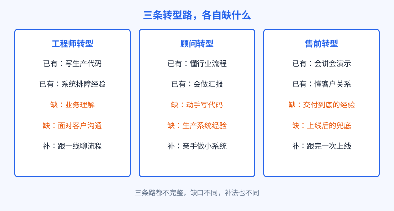
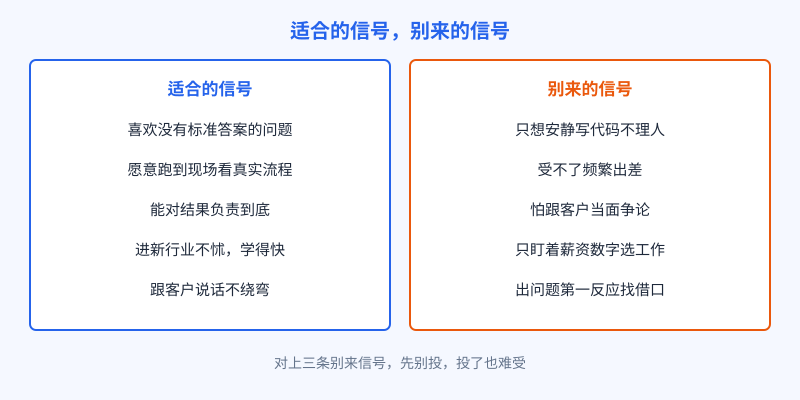

# 第 28 章 谁适合，谁别来

## 开场

先听小柯自己说。进临江精工之前，他在原公司做了四年纯后端：接需求，写接口，修线上问题，日子安稳。转到 FDE 岗的头一个月，他过得很别扭。代码写得少了，时间全花在车间里：看工人怎么扫码，听班组长抱怨系统卡，陪王工在设备边上蹲着对数据。他一度怀疑自己退步了。转折点在第三周：质检助手老误报，他没有先改模型，而是跟着夜班走了一整圈，发现误报全出在灯光角度变化的那两个工位。当天改了取图方式，误报砍掉大半。那一刻他说自己才明白，这个岗位的技术，一半在屏幕外。

小柯的经历能说明一件事：适不适合做 FDE，不看你现在是什么岗位，看你缺的那一块愿不愿意补，以及有些劝退项你能不能接受。

## 白话讲解

FDE 的转型来源主要是三类人：工程师、顾问、售前。三类人各有本钱，也各有缺口，不存在哪条路天然占便宜。

图：三条转型路，各自缺什么。工程师缺业务和沟通，顾问缺动手，售前缺交付到底的经验。

工程师转型，代码和排障是现成的，缺的是坐在客户对面把需求问清楚、把流程看明白的耐心。顾问转型，懂行业、会汇报是现成的，缺的是亲手写生产代码，方案落不了地就露馅。售前转型，会讲产品、会做演示是现成的，缺的是上线之后留下来兜底的经历，而 FDE 的活恰恰从演示结束才开始。

除了技能缺口，还有一组更重要的判断：性格和生活方式合不合。下面这张图，右边对上三条，建议先别投。

图：适合的信号，别来的信号。技能可以补，生活方式和脾气补不了。

劝退项提前说清。第一是出差和驻场，项目在哪人就在哪，一段几个月是常态，家里有牵挂要先谈好。第二是压力，客户的问题就是你的问题，上线节点前没有可以躲的角落。第三是背锅，系统出事时客户第一个找的就是现场的人，解释和担责都跑不掉。第四是身份模糊，你既不是客户的人，也不是纯粹的产品方，两边都要交代，玻璃心做不久。

三条路还有一个共同门槛，叫学习速度。FDE 进的每个行业都不一样，上一个项目在汽车零部件，下一个可能去物流或者医院。行业知识没有存量可吃，全靠进场后现学：两周内要能听懂客户的黑话，一个月内要能画出他们的主流程。学习速度慢的人不是不聪明，是节奏跟不上，项目不等人。检验方法很诚实：回想你上一次钻进一个完全陌生的领域，花了多久才敢开口提建议。如果答案是半年起步，这个岗位会让你长期处于难受的状态；如果答案是几周就能上手聊业务，你已经过了一道大关。

至于很多人关心的薪资，只给公开口径：美国市场岗位广告里，这个岗位的广告薪资中位数约 19.5 万美元（CNBC 引用口径）。注意这是招聘广告上的数字，不是到手收入，更不是对任何人的承诺。国内岗位的口径完全不同，为了高薪数字跨行，多数人会失望。

## 陆远的现场

陆远劝退过一位后端工程师。对方最后一句问得直接：听说这行薪资高，跳过来能涨多少。陆远把劝退项摆给他：外地驻场至少三个月，上线前两周没有准点下班，汇报会被厂长拍桌子。对方沉默了一会，说出差倒行，就是怕担责，出事习惯等组长定调。陆远当场劝他别来：不是能力不行，是这个岗位最大的成本就是担责，躲责的人待不过第一个项目。劝退不是淘汰，是帮双方省时间。

反过来看小柯为什么留下来：不怕跑车间，不怕当面确认流程，出问题先到现场看，不先在群里发消息。缺的业务理解，他用三个月驻场补上了。陆远说，小柯这种人入职时不是最强的，但长得最快。

## 翻车现场

有一家公司招 FDE 只看两样：名校背景和算法题分数，招进一位技术很强的年轻人。派到客户现场第二周，他把客户用了多年的土办法批得一文不值，当着车间主任的面说流程设计不合理。话没有错，场合全错。车间主任从此开会不再叫他，关键数据也不经他的手，项目只能靠转述的信息推进。两个月后公司把他换下，换上技术稍弱、愿意先跟着干两周再开口的工程师，项目才回到正轨。教训很朴素：现场能力不是附加项，是入场券。技术再强，进不了客户的门，一切都是零。这个岗位的筛选如果只筛技术，等于把最贵的一课留给客户去教。

## 要点回顾

- 三条转型路各有缺口：工程师补业务和沟通，顾问补动手，售前补交付到底。
- 技能缺口三个月到半年能补，生活方式和脾气补不了，先对劝退清单。
- 劝退四条：频繁驻场、上线压力、现场担责、身份模糊。
- 薪资只看公开口径，广告数字不是承诺，为钱而来的人最容易失望。
- 适合的人有共同点：愿意到现场、出问题先到场、对结果负责到底。

## Kata

1. 拿一张纸，左边写你的本钱，右边写你的缺口，对照本章三条转型路，你在哪条路上，第一个要补的缺口是什么，用什么具体动作补。
2. 把劝退四条逐条打分：一到五分表示接受程度。哪一条低于三分，想清楚：是能谈条件解决，还是这条路本身就不适合你。
3. 找一次你参与过的跨团队协作，复盘一个细节：当时出问题，你是先到现场看，还是先等别人定调。把答案写下来，这是面试时也会被问到的问题。
