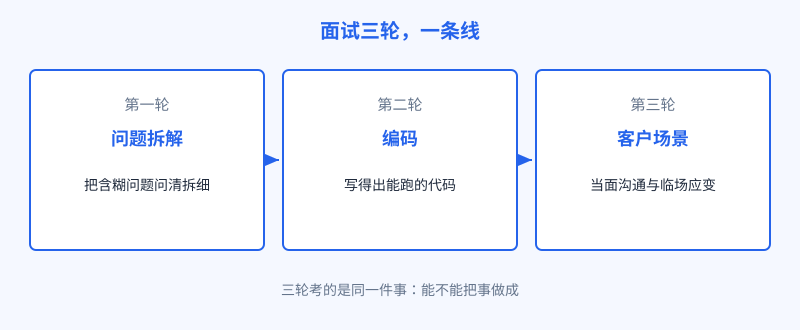
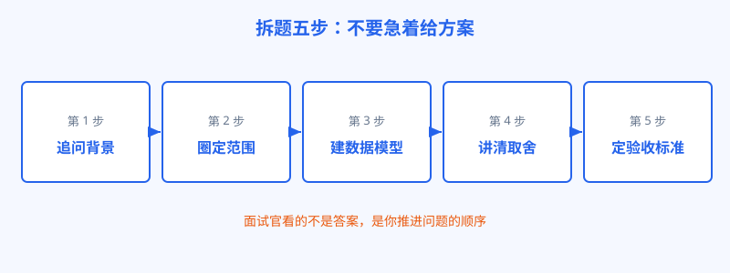

# 第 29 章 面试拆解

## 开场

很多人准备 FDE 面试，走的是准备普通工程师面试的老路：刷题背八股，把算法题刷到滚瓜烂熟。结果第一轮就被问懵。面试官抛过来的不是一道题，而是一团雾：一家工厂的订单老是延期，数据散在四个系统里，老板问能不能用 AI 帮忙，你怎么办。没有标准答案，没有输入输出，只有四十分钟，看你怎么把这团雾一层层拨开。这就是这类岗位最有代表性的一轮：问题拆解轮。它源自 Palantir 的经典考法，后来被各家学了过去。这一章把三轮面试逐轮拆开讲：每轮考什么，怎么准备，死人在哪。

## 白话讲解

FDE 的面试通常是三轮，考的是同一条线：能不能把事做成。

图：面试三轮，一条线。拆解看思路，编码看手艺，场景看现场感。

| 轮次 | 形式 | 主要考什么 | 常见的死法 |
|---|---|---|---|
| 问题拆解轮 | 给一个含糊的企业问题，现场拆解 | 提问能力、建模能力、取舍判断、表达顺序 | 不问背景直接给方案；只谈技术不谈业务；不提数据从哪来 |
| 编码轮 | 限时写代码或结对编程 | 能不能写出能跑、能读、能改的代码 | 只顾炫技；不写测试意识；边写边不说话，对方看不到思路 |
| 客户场景轮 | 角色扮演或案例讨论 | 沟通、预期管理、冲突处理、担责意识 | 承诺做不到的事；客户一施压就全盘让步；甩锅给产品和客户 |

拆解轮是重头戏，再单独放大看。正确的推进顺序是五步，顺序错了印象分就没了。

图：拆题五步：不要急着给方案。先追问，再圈范围，然后建模、讲取舍、定标准。

第一步追问背景：这个问题谁提的，影响哪个指标，现在靠什么办法硬撑。第二步圈定范围：先做哪一段，明确不做什么。第三步建数据模型：需要哪些数据，各在哪个系统，口径怎么对齐，这是 Palantir 式拆题的标志动作，很多人会跳过它直接聊模型选型，基本就出局了。第四步讲清取舍：方案不止一个，快和稳、自动和人工兜底，各自代价说清楚。第五步定验收标准：做到什么程度算成，谁来确认。能把五步走完，答案本身对不对反而没那么重要。

编码轮再多说一句，免得准备错方向。这一轮通常不考刁钻的算法难题，难度更接近日常工作：处理一份脏数据，对接一个接口，把一段逻辑写清楚并能讲出边界情况。原因是岗位本身的写法就摆在那里：FDE 每天写的是集成、数据处理和业务逻辑，不是竞赛题。但不考难题不等于可以裸考，手感生疏的人在限时和注视下会连常用写法都卡住。每周保持两到三次限时练习，每次写完自己复盘一遍可读性和边界处理，比突击刷难题清单管用得多。另外记得一件事：写不出最优解时，把暴力解法先完整写出来并说明改进思路，得分远高于对着空文件想十分钟。

准备方法也随之清楚：拆解轮靠平时拆真实问题的积累，找几个公开的企业场景自己拆，写出追问清单；编码轮保持手感，重点练数据处理和接口类题目，写的时候出声讲思路；场景轮准备两三个自己亲历的冲突故事，按当时怎么处理、结果如何的结构讲。

## 陆远的现场

陆远当面试官时用过一道拆题：一家连锁餐饮的门店补货老是不准，总部想用 AI 预测销量，你来做，怎么办。第一位候选人开口就讲模型：用什么算法，怎么调参，讲了十分钟没停。陆远打断他问了三个问题：每家店现在的补货是谁定的，数据在哪个系统里，预测错了谁承担报废。候选人全答不上来，也没有要问的意思。这一轮就此结束。第二位候选人先反问：是所有门店都不准，还是某几类门店；报废率高的是生鲜还是标品；店长现在凭什么下单。问完才动手，在纸上画出门店、仓库、销售流水三张表的关系，然后说先挑十家店做试点，标准是报废率下降且不断货。技术部分他讲得不多，但每句都落在数据和验证上。陆远后来给的评语是：第二位已经在上班状态了，第一位还在考试状态。面试拆题，拆的从来不是题，是你面对真实问题的习惯。

## 翻车现场

翻车最常见的一种，是把拆解轮当成咨询炫技场。有位候选人背景不错，拿到题目后大谈行业趋势和组织变革，框架一套接一套，听起来很高级。二十分钟过去，面试官问了一句：第一周你具体做什么。他答：先做全面调研，输出一份诊断报告。这一句基本宣判出局。FDE 招的是能下场交付的人，第一周的正确答案永远带着具体的动作：找谁谈，调哪些数据，做出什么能看的东西。另一类翻车是场景轮乱承诺：客户提出不合理的时间要求，候选人为了表现积极满口答应。面试官想看的恰恰相反：你会不会把风险说在前面，把范围谈清楚，把做不到的话体面地说出来。现场工作里，乱承诺的人是最危险的人。

## 要点回顾

- 三轮面试考同一条线：拆解看思路，编码看手艺，场景看现场感。
- 拆解轮五步：追问背景、圈定范围、建数据模型、讲清取舍、定验收标准。
- 跳过数据模型直接聊技术选型，是拆解轮最常见的出局原因。
- 编码轮不只看对错，出声讲思路，让对方看到你的推进过程。
- 场景轮的加分项是把风险说在前面，减分项是乱承诺和甩锅。

## Kata

1. 找一个含糊的企业问题，比如仓库老是爆仓，按拆题五步写一份拆解：至少列出十个要追问的问题，再给出范围、数据模型和验收标准。
2. 把你简历上最得意的一个项目改写成场景题的答法：当时客户有什么分歧，你怎么处理的，结果如何，三分钟讲完，录下来听一遍。
3. 找一道数据处理类编码题，限时四十分钟，边写边出声讲解。回放检查：你的思路有没有出现长时间沉默，关键取舍有没有说出口。
