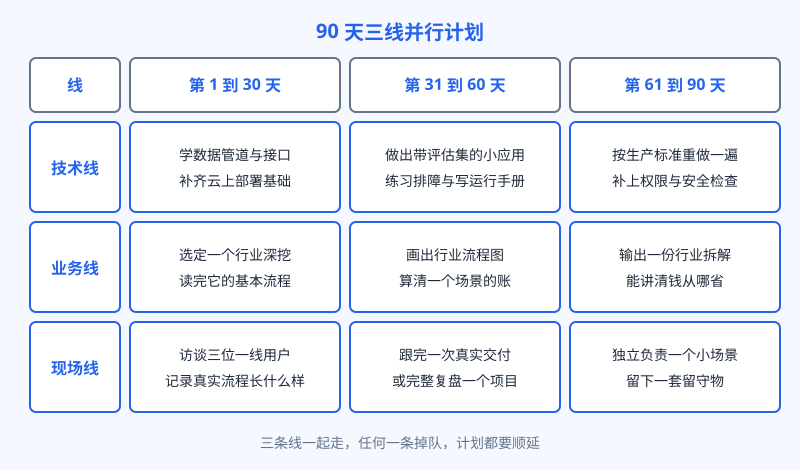
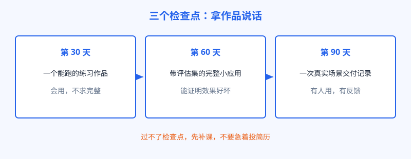

# 第 30 章 90 天转型计划

## 开场

计划先说清一个前提：90 天不是速成班，是把转型拆成能验收的三段。这一章的计划是给已经在职的工程师、顾问和售前用的，用业余时间加工作中的真实机会推进，每天能挤出一到两小时就能跑。如果现在手头完全没有真实场景可用，第三段的现场线可以先用复盘和模拟代替，但要在投简历前补上真实交付的证据。计划的主体是一张表：三条线并行，每 30 天交一件作品。先选行业，再选公司，这句话贯穿全程，因为 FDE 的价值一半在行业里，行业选错，后面全要重来。

## 白话讲解

三条线是：技术线补生产级的硬功夫，业务线选定一个行业往深里走，现场线练跟真实的人和流程打交道。三条线必须一起走，只补技术会变成更熟练的后端，只补业务会变成懂点技术的顾问。

图：90 天三线并行计划。技术、业务、现场三条线同步推进，每 30 天各交一件作品。

执行时对照下面这张节奏表看，每一段都有明确的交付物。

| 阶段 | 技术线 | 业务线 | 现场线 | 本段交付物 |
|---|---|---|---|---|
| 第 1 到 30 天 | 学数据管道与接口，补云上部署基础 | 选定一个行业，读完它的基本流程 | 访谈三位一线用户，记录真实流程 | 一个能跑的练习作品 |
| 第 31 到 60 天 | 做出带评估集的小应用，练排障与运行手册 | 画出行业流程图，算清一个场景的账 | 跟完一次真实交付，或完整复盘一个项目 | 带评估的完整小应用 |
| 第 61 到 90 天 | 按生产标准重做：权限、安全、监控补齐 | 输出一份行业拆解，能讲清钱从哪省 | 独立负责一个小场景，留下一套留守物 | 一次真实场景交付记录 |

为什么先选行业？FDE 在现场的判断力来自对行业的熟悉：知道哪道工序最贵，哪个指标老板最怕，哪些话一线不爱听。这些换一家公司要重新攒，但换同一个行业内的公司，大部分能带走。选行业只看三条：这个行业的企业正在真金白银上 AI，流程复杂到离不开现场，它的规模撑得起一支 FDE 队。制造业、金融、医疗、物流、零售是常见的落点，结合自己已有的积累选，不要追最热的。

时间从哪来，也要提前算好。在职推进的人，每周能稳定拿出的通常是六到十个小时，分配原则是三条线都沾，不许整周只喂一条线。一个可参考的节奏：两个工作日晚上给技术线，周末半天给业务线，现场线的访谈和跟项目尽量借工作本身的机会完成，实在借不到，就用复盘旧项目顶上并写清差距。还有一个硬规矩：每周留半小时对表，只看交付物推进了多少，不看学了多少。计划最怕自我感动，学了多少是自己知道的，交付物才是别人能验的。真遇到工作忙到挤不出时间，正确做法是把计划顺延并写明新的检查点日期，而不是把两段压成一段糊弄过去。检查点的日期可以动，交付物的标准不能降。

检查点比日程更重要。跑满 90 天但拿不出作品，等于没跑。

图：三个检查点：拿作品说话。第 30 天看手感，第 60 天看完整度，第 90 天看真实交付。

## 陆远的现场

这份计划是陆远带小柯师弟时用过的版本：师弟是实施出身，想转 FDE，陆远让他先别投简历，按这张表跑。过程里两处差点掉链子。第一处在第 40 天：业务线停了，流程图画不下去，他只懂系统操作，不懂业务为什么这么定。补救是换访谈对象：不找信息部门，找两位跑业务的老员工每周聊，两周后补齐。第二处在第 75 天：小场景差点黄掉，客户方负责人换人，新负责人没兴趣。师弟没硬推，先帮对方解决一个报表口径的小麻烦，信任回来，场景才继续。90 天结束时他手上有三样东西：带评估集的小应用、行业流程拆解、一次小场景的完整交付记录。投简历时这三样就是谈资，拆解题的追问、建模、验收，他全有真实素材。结果不写在这里，因为计划管的是过程，管不了每个人的结果。

## 翻车现场

最常见的翻车是把 90 天过成听课季。有人三个月囤了十几门课的证书，笔记记了几大本，一问作品，两手空空。课和证书在 FDE 的筛选里几乎不加分，作品才加分。第二种是只练舒服的那条线：工程师背景的人把 90 天全花在技术上，业务访谈一次没做，面试场景轮还是过不去。第三种是行业三天两头换，每个都浅尝辄止，等于没有行业。用检查点管住自己，是这份计划真正的用法：每 30 天拿交付物对表，缺哪条线，下一段先补哪条，不许用加时长糊弄过去。

## 要点回顾

- 90 天计划三条线并行：技术补生产功夫，业务选行业深挖，现场练真实交付。
- 先选行业再选公司，行业判断力是 FDE 能带走的资产。
- 每 30 天一个检查点，交付物分别是练习作品、带评估的小应用、真实交付记录。
- 访谈对象要选一线业务的人，只聊信息部门画不出真实流程。
- 课和证书不算进度，作品才算；缺哪条线先补哪条，不许只练舒服的。
- 日期可以顺延，交付物的标准不能降，这是计划唯一的硬规矩。

## Kata

1. 按自己的背景把本章的节奏表改一版：每条线写清这 30 天的具体动作和交付物，贴在看得见的地方，本周就启动第一段。
2. 用选行业三条标准，给你候选的三个行业逐个打分，选出一个，写下放弃另外两个的理由。
3. 约一位目标行业的一线从业者聊半小时，只问流程不问系统：他的一天怎么过，最烦哪一步，数据在他手里是什么样子。把记录整理成一页。
