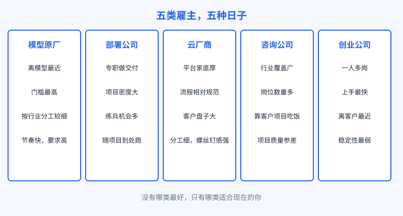
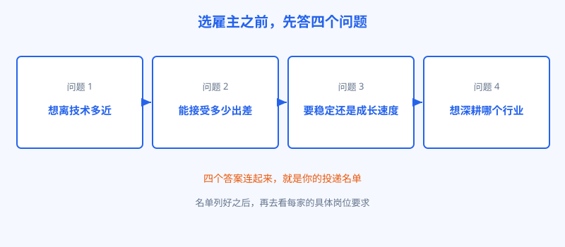

# 第 31 章 去哪投，投哪种

## 开场

全书最后一章，回答一个很实际的问题：决定做 FDE 之后，简历往哪投。同样是 FDE 的职位，在五类雇主手里是五种完全不同的日子：离模型近不近，出差多不多，项目节奏快不快，三年后你身上留下什么。投错了不是能力问题，是日子和预期对不上，干几个月就想走。这一章先把五类雇主逐个讲清，再给一套选法，最后回到全书开头的问题做个收束。

## 白话讲解

五类雇主分别是：模型原厂、部署公司、云厂商、咨询公司、创业公司。它们的 FDE 形态，都能在第二篇的大厂时间线里找到源头。

图：五类雇主，五种日子。差别不在头衔，在每天的日程和三年后的积累。

模型原厂，就是 OpenAI、Anthropic 这样的公司直招的 FDE 和 Applied AI 岗位。离模型和产品团队最近，新能力第一时间到手，要求也最高，通常按行业分组，招有对应行业经验的人。部署公司是 2026 年的新物种：OpenAI 的 Deployment Company、Anthropic 参与的 Ode 这类专门为交付而生的公司，FDE 是它们的主业，项目密度大，练兵最快，代价是跟着项目走，出差和驻场最多。云厂商如 AWS、微软、Google Cloud，家底是自家云平台，FDE 的活和平台绑定深，流程规范，客户盘子大，适合想在成熟体系里稳步走的人。咨询公司如 Deloitte、Accenture、KPMG，FDE 岗位数量位居前列，行业覆盖最广，进去能摸到多个行业，但项目质量看分配运气，也要适应咨询业的汇报和工时文化。创业公司的 FDE 最杂：公司小，岗位边界模糊，一个人从售前聊到上线兜底全包，上手最快，抗风险能力也最弱，公司本身活不活得下去是第一个变量。

选的时候不要先看公司名，先回答四个问题，答案会自己把名单筛出来。

图：选雇主之前，先答四个问题。四个答案连起来，就是你的投递名单。

投递的顺序也有讲究：先投和自己行业积累对口的岗位，面试通过率和入职后的上手速度都占便宜；五类里优先投两类以内的，不要海投所有类别，每一类的面试准备方式不一样，拆解题的行业背景也不同。薪资仍然只说公开口径：美国市场岗位广告薪资中位数约 19.5 万美元，是广告数据，不同雇主、不同城市差别很大，国内另行看各家招聘页，不要拿这个数字当谈判锚点，更不要当收入预期。

## 陆远的现场

陆远帮一位同行选过。这位同行在云厂商做了四年解决方案，手艺不差，想转 FDE，纠结于两个机会：一个是部署公司的高级 FDE，出差比例过半；一个是制造业创业公司的首位 FDE，常驻本地客户。陆远没替他选，而是拉着他过四问。离技术：他想回到写代码的状态，两家都满足。能接受多少出差：他孩子刚上小学，答案是越少越好，这一条先筛掉了部署公司。稳定还是成长：他更想要成长速度，但前提是家庭节奏不被打乱。行业：他父亲在工厂干了一辈子，他自己也做过两个制造项目，心里其实早有答案。四问过完，他选了创业公司。陆远提醒他把风险摆上桌谈：公司现金流、这个岗位向谁汇报、第一年算成的标准是什么，都在入职前问清。一年后回访，他在那家公司带起了三人小队。选对的核心不是哪家更强，是四个答案和岗位的日常对不对得上。

## 翻车现场

翻车的典型是只看头衔和薪资数字投递。有人冲着原厂的光环进去，才发现岗位按行业切得很细，自己被分到完全陌生的行业，每天都在补课，半年还没进入状态。也不能怪公司：原厂招人时写的行业方向就是筛选条件，他投递时没当回事。另一类翻车是进了咨询公司的 FDE 岗，却受不了多项目并行和频繁汇报，觉得和想象中深扎一个客户的日子完全不同。岗位职责写得清清楚楚，是他自己只看了职位名称没看日常。教训只有一条：面试是双向的，反问环节要问具体日程，出差比例多少，常驻客户还是多项目轮转，汇报线是谁，第一年交付什么。这些问题不问清，入职后的落差全是自找的。

## 要点回顾

- 五类雇主，五种日子：原厂离模型最近，部署公司练兵最快，云厂商体系最稳，咨询公司行业最广，创业公司最杂也最险。
- 选雇主先答四问：离技术多近、能接受多少出差、要稳定还是成长、深耕哪个行业。
- 投递先对口行业，五类里聚焦两类以内，每类面试准备方式不同。
- 面试反问要问到具体日程：出差比例、项目形态、汇报线、第一年的成功标准。
- 薪资只参考公开口径，广告数字不是锚点，更不是预期。

## Kata

1. 用四问给自己写一份一页的答案，然后把你正在看的岗位按匹配度排序，只保留前五，写清每个岗位不匹配的点在哪。
2. 给你想投的两类雇主各找三个真实岗位，把职责逐条读完，标出日程类信息：出差、驻场、项目形态，缺的信息列成反问清单。
3. 给三年后的自己写一段话：你希望身上留下哪种积累。再回头看五类雇主，哪一类最容易把你带到那里，把这条写进投递排序的理由里。

## 收束

回到前言的那个问题：模型已经够强了，为什么 AI 还是落不了地。全书绕了一大圈，答案其实很简单：落地从来不是模型一个人的事，它是数据、流程、组织和人的事。2026 年大厂把几十亿美元花在 FDE 身上，买的不是更多的代码，而是把事做成的能力。所以这个岗位真正值钱的地方，不在头衔，也不在一时的热度，在于它逼着一个人同时懂技术、懂业务、懂现场，还能对结果负责到底。模型会越来越强，工具会越来越便宜，但坐在客户身边，把一团乱麻拆开、把系统推上生产、把人教会、把摊子收好的人，不会因此过时。如果你决定走这条路，从下一件真实的小事开始。把事做成，就是这个岗位的全部秘密。
